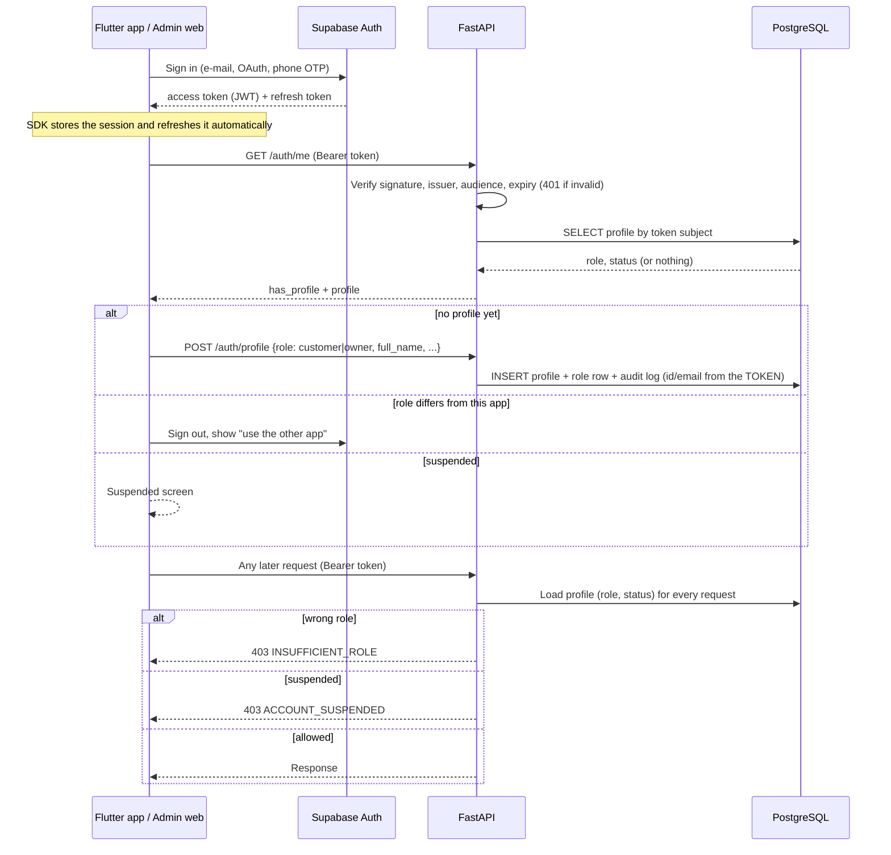
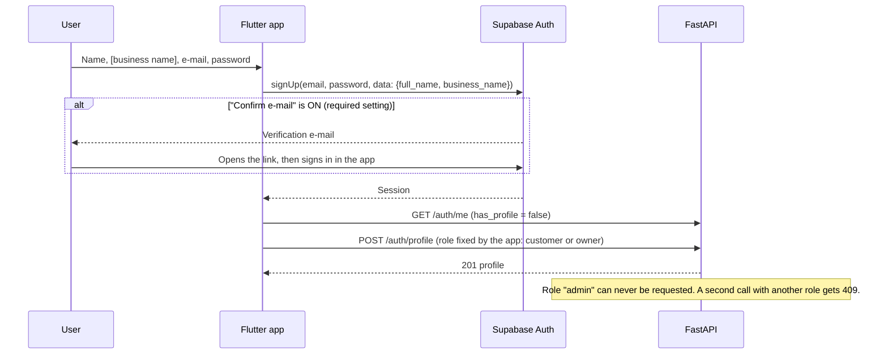
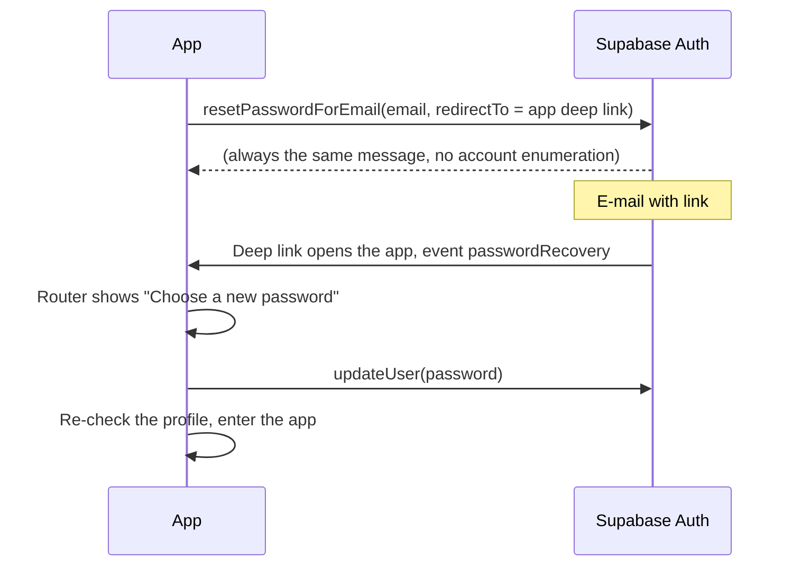
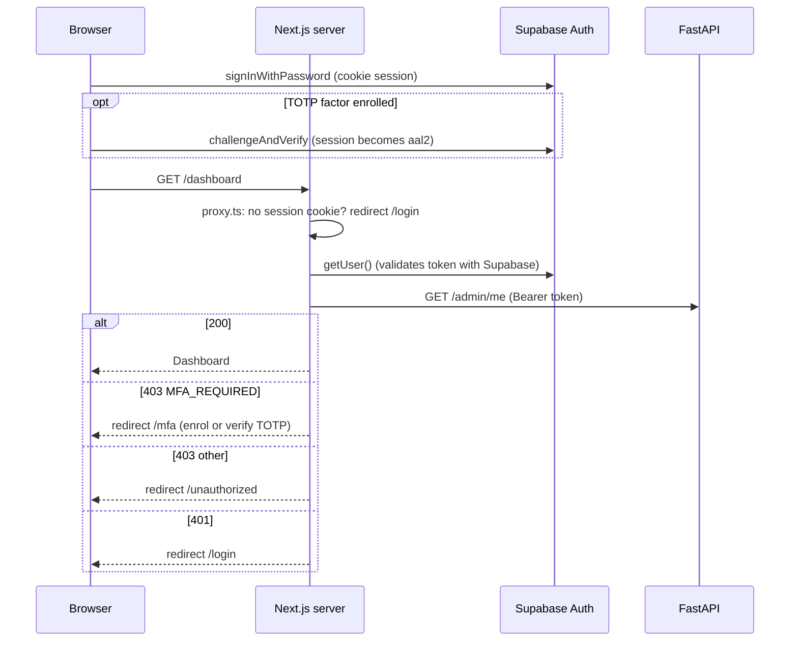

# Authentication flow

Supabase Auth handles credentials, sessions and token refresh. FastAPI never sees passwords: it verifies the Supabase access token and then loads the account's **role and status from its own `profiles` table**.

## Methods

| Method | Mobile app (customer / owner) | Admin web | Status |
|---|---|---|---|
| E-mail + password (with e-mail verification) | ✔ | ✔ (admins only) | Implemented |
| Password reset (e-mail link, in-app "new password" screen) | ✔ | not built | Implemented in apps |
| Google OAuth | ✔ (native picker + Supabase `signInWithIdToken`, browser fallback; behind `GOOGLE_AUTH_ENABLED`) | ✖ | Implemented, **needs Google/Supabase setup**: see GOOGLE_SIGN_IN_SETUP.md. Google sign-ups are always `customer`. |
| Apple OAuth | ✔ iOS only (behind `APPLE_AUTH_ENABLED`) | ✖ | Implemented, **needs dashboard setup** |
| Phone OTP | ✔ (behind `PHONE_AUTH_ENABLED`) | ✖ | Implemented, **needs an SMS provider (open question N24)** |
| TOTP second factor | ✖ | ✔ (enrol + verify; required in staging/production) | Implemented |

Buttons for Google, Apple and phone are hidden unless their `*_AUTH_ENABLED` flag is set, so the apps never show a method that cannot work yet.

## Sign-in and request authorisation

## Registration (customer or owner)

`user_metadata` (name, business name) only **pre-fills** the profile. It is user-editable, so it is never used for permissions.

## Password reset

## Admin web

The browser never decides who is an admin: the page is rendered only after the API confirms, and each dashboard request is re-checked (no caching).

## Token handling

| Concern | Behaviour |
|---|---|
| Verification | Signature, `exp` (10 s leeway), `iss`, `aud=authenticated`, required `sub`/`exp`. `alg=none` and algorithm confusion are rejected. Asymmetric keys are fetched from the project JWKS and cached; legacy projects use `SUPABASE_JWT_SECRET` (HS256). |
| Expired / bad token | 401 `TOKEN_EXPIRED` / `INVALID_TOKEN`; the apps sign the user out on 401. |
| Refresh | Done by the Supabase SDK in the apps and in the Next.js proxy; the API only ever sees fresh tokens. |
| Session restoration | Apps restore the stored session on start, confirm it with `/auth/me`, then enter the app (splash meanwhile). |
| Logout | `signOut()` in the apps and admin web. (Server-side revocation of an already issued access token is not possible until it expires, normally ≤ 1 hour; a suspended account is blocked immediately by the profile check.) |
| Unconfigured | No JWT secret/JWKS → every protected route answers 401 `AUTH_NOT_CONFIGURED` (fails closed). |

## Required Supabase dashboard configuration

None of this can be done by the code, and **none of it has been tested against a real project** (no credentials were provided).

1. **Authentication > Providers > Email**: enabled; **Confirm email = ON**; minimum password length 8.
2. **Authentication > URL Configuration**: Site URL = admin web URL; **Redirect URLs** must include `io.zuruv.app://login-callback` (the one mobile app; the old `io.zuruv.customer` / `io.zuruv.owner` entries can be removed), and the admin URL (and `http://localhost:3000` for development).
3. **Google**: in Google Cloud Console create an OAuth client (type *Web*), authorised redirect URI `https://<project-ref>.supabase.co/auth/v1/callback`; paste Client ID/secret into Authentication > Providers > Google. Set `GOOGLE_AUTH_ENABLED=true` in the app's env JSON.
4. **Apple**: in the Apple Developer account create a Services ID, a Sign in with Apple key (.p8), note Team ID and Key ID; configure Authentication > Providers > Apple. The client secret is a JWT that must be regenerated at least every 6 months. Set `APPLE_AUTH_ENABLED=true`. (iOS apps that offer other third-party sign-in generally must offer Sign in with Apple; confirm against current App Store rules.)
5. **Phone**: Authentication > Providers > Phone; choose an SMS provider (open question **N24**: none is in the approved stack); India needs sender/template (DLT) registration with lead time. Set `PHONE_AUTH_ENABLED=true` only after it works.
6. **Multi-factor**: Authentication > Multi-Factor: enable TOTP (enrol and verify). Admin accounts: create the user (Authentication > Users > Add user), run `python -m scripts.create_admin`, then sign in to the admin web and enrol the authenticator.
7. **JWT**: Project Settings > JWT Keys. New projects: leave `SUPABASE_JWT_SECRET` empty (JWKS is derived from `SUPABASE_URL`). Legacy shared-secret projects: set `SUPABASE_JWT_SECRET`.
8. **Data API**: remove `public` from the exposed schemas (or disable the Data API). RLS already protects the tables, but the apps never use PostgREST.
9. **Deep links in the apps** (platform folders are generated by `scripts/bootstrap_flutter.sh`): add an Android intent filter and an iOS URL scheme for `io.zuruv.app` so the e-mail, reset and OAuth links reopen the app.
10. Recommended: enable CAPTCHA / rate limits on sign-up and sign-in.

## Account status

`profiles.status` is `active` or `suspended`. Suspension is enforced on every API call and in RLS. There is no endpoint to change it yet (admin account management is Step 8, permissions per open question Q18); until then an operator changes it in the database.
