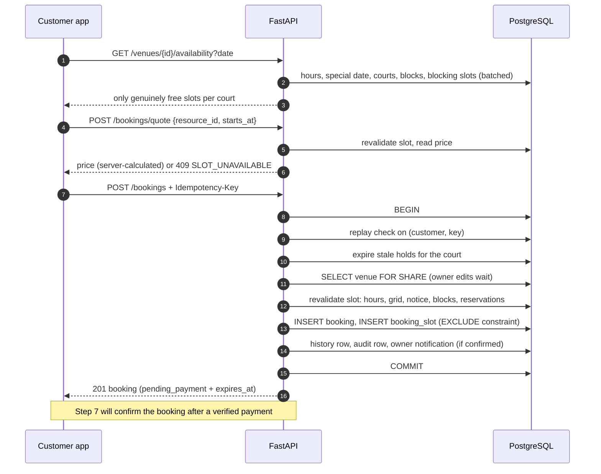
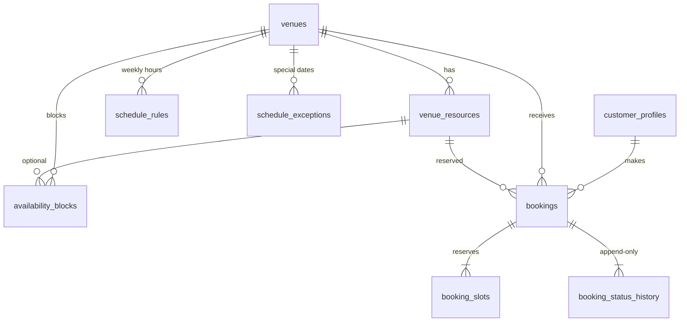

# Booking engine (Step 6)

FastAPI + PostgreSQL. Implements `SYSTEM_ARCHITECTURE.md` §9. Payments (Razorpay) are **not** part of this step: bookings are created as unpaid holds and confirmation by payment arrives in Step 7.

## Business model used (and what is still open)

The brief says not to invent answers. The model below is the **smallest one that works with the approved architecture**; every choice that the business has not confirmed is listed in `STEP_6_REPORT.md` §6.

- A venue has one or more **courts** (`venue_resources`). The owner gives each court a slot length (minutes) and a price per slot. A court with either value missing is "not configured" and cannot be booked (Q1, Q2, Q17, N2, N23 unresolved).
- One booking = one slot on one court. The database model already allows several slots per booking.
- The customer chooses the court (no auto-assignment, N3).
- Opening hours stay venue-level (Step 5 tables) and apply to every court; a special date replaces the weekly hours (Q16 precedence).
- Price = the court's slot price × 1. Fees, tax, discount and commission are 0 and not calculated (Q7, Q8, N7). The result is stored on the booking as a `price_snapshot`.

## Booking flow

## Double-booking prevention (concurrency strategy)

Four layers, from the cheapest check to the last line of defence:

1. **Revalidation inside the transaction.** The requested start must equal a generated slot; the slot must not overlap any live reservation or block. Failing gives a clean `409 SLOT_UNAVAILABLE` (or `422 INVALID_SLOT` / `SLOT_NOT_BOOKABLE`).
2. **Database exclusion constraint** on `booking_slots`:
   `EXCLUDE USING gist (resource_id WITH =, slot_range WITH &&) WHERE (is_blocking)`.
   Two overlapping *blocking* rows on one court can never exist, whatever the application does. Two simultaneous requests both pass step 1, but the second insert either waits for the first to commit and then fails with SQLSTATE `23P01`, which the service converts to `409 SLOT_UNAVAILABLE`, or the first rolls back and the second succeeds. Half-open ranges `[start, end)` make back-to-back slots legal.
3. **Venue row locks.** Booking creation takes `SELECT … FOR SHARE` on the venue row; every owner change to hours, courts, blocks, time zone or deletion takes `FOR UPDATE`. A booking and a schedule change on the same venue are therefore serialised: either the booking commits first and the change is refused (`SCHEDULE_CONFLICT`), or the change commits first and the booking is rejected. Many bookings still run in parallel (share locks do not block each other).
4. **Idempotency.** `Idempotency-Key` is unique per customer (partial unique index). The same key with the same body returns the original booking (`200` instead of `201`); the same key with a different body is `422 IDEMPOTENCY_KEY_REUSED`. Concurrent retries of one request create exactly one booking. A request that loses a race on the slot but whose key already produced a booking is answered as a replay, not as a conflict.

When a holder cancels or its hold expires, its slot rows stop blocking in the same transaction (`is_blocking = false`), so the slot can be booked again immediately. Releasing a hold never needs a background job because stale holds are also ignored by queries (see `AVAILABILITY_LOGIC.md`).

Rollback: every failure path raises inside the transaction; the session is rolled back and nothing is half-written. The exclusion violation is raised inside a savepoint (`begin_nested`) so the rest of the request can still be answered.

### Verified by tests (real PostgreSQL, real threads)

`tests/test_booking_concurrency.py`: 10 customers race for one slot → exactly one `201`, nine `409 SLOT_UNAVAILABLE`, one booking row; 6 simultaneous retries with one key → one booking; 8 customers on 8 different slots → 8 × `201`; two courts at the same time → both succeed; a booking racing an owner closing that day → never both; a raw SQL insert that bypasses the service is refused by the constraint, while a non-blocking or back-to-back row is accepted. Each test uses separate app instances and separate database pools (genuine parallel connections).

## Database

New in migration `0006` (down-migration included, round-trip tested). Existing `venue_resources` gained `slot_minutes` and `slot_price_paise`; no table was duplicated.

| Table | Purpose and constraints |
|---|---|
| `bookings` | One row per booking: `booking_code` (unique, `ZUR-` + 8 characters from an unambiguous alphabet), customer, venue, court, `status` (9 values, CHECK), `payment_status` (`unpaid` … `refunded`, CHECK), `booking_date` (venue-local), `starts_at`/`ends_at`/`duration_minutes` (CHECK that they agree), `base_amount_paise`, `total_amount_paise` (≥ 0), `currency`, `price_snapshot` jsonb, venue/court name and time zone snapshots, `expires_at` (required while `pending_payment`), `idempotency_key` + `request_hash`, `confirmed_at`, `cancelled_at`, `cancelled_by`, `cancel_reason`, `created_at`. FKs are `RESTRICT`: a customer, venue or court with bookings cannot be deleted. |
| `booking_slots` | The reserved time: `slot_range tstzrange` (bounded, non-empty), `is_blocking`, **the exclusion constraint above**. |
| `booking_status_history` | `from_status`, `to_status`, `actor_id`, `actor_role`, `reason`. A `BEFORE UPDATE` trigger blocks edits. |
| `availability_blocks` | Owner temporary unavailability (`resource_id` NULL = whole venue). |

Indexes: bookings by customer, venue, court, status and holds; unique code; unique `(customer_id, idempotency_key)`; GiST on slots. RLS is enabled on all four; clients get `SELECT` only (customers own rows, owners their venues' rows, admins all) and every write goes through the API.

Deleting a venue that has any booking is refused (`409 VENUE_HAS_BOOKINGS`, revisits D-56); a court with bookings must be deactivated, not deleted (`409 RESOURCE_HAS_BOOKINGS`).

## Security

- Every route requires a JWT; role is read from the database, not the token. Customers: `/bookings…`; owners: `/owners/…`; admins: `/admin/…`.
- **IDOR:** another customer's booking, another owner's booking/venue/court/block all answer `404` with the same body as a missing record (no existence leak).
- Clients never send a price, duration, status or customer id; extra fields are rejected (`422`).
- Owners see the customer's **name only** (phone/e-mail visibility is open, N9).
- Booking events are recorded in `audit_logs` (`booking.created`, `booking.cancelled`, resource and block changes) and in-app owner notifications (`booking.created`, `booking.cancelled`) when a booking is confirmed or a confirmed booking is cancelled. Unpaid holds are hidden from owners until confirmed (D-60).

## Code map

`app/domain/slot_engine.py` (pure slot rules), `pricing.py`, `booking_state.py`; `app/services/availability.py`, `bookings.py`, `owner_resources.py`, `schedule_guard.py`; endpoints `bookings.py`, `owner_resources.py`, `owner_business.py` (owner bookings), `admin.py`; migration `0006_booking_engine.py`. Tests: `test_slot_engine.py` (11, no database), `test_booking_api.py` (23), `test_booking_concurrency.py` (6).
