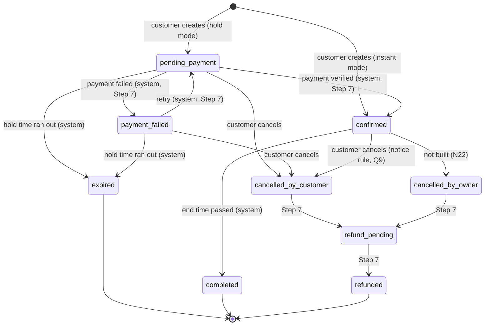

# Booking status flow (Step 6)

Status model from `SYSTEM_ARCHITECTURE.md` §9.4. It is a **proposal pending Q11** (the business has not confirmed the statuses); the code is built so adding a status is a one-line change in `app/domain/booking_state.py` plus a CHECK in a migration.

## Statuses

| Status | Meaning | Reserves the slot? |
|---|---|---|
| `pending_payment` | Created, waiting for payment. Has `expires_at`. | **Yes** |
| `payment_failed` | A payment attempt failed (set by Step 7 only). | **Yes** until expiry |
| `confirmed` | Booking is valid (paid in Step 7, or created in `instant` mode). | **Yes** |
| `expired` | The hold ran out without payment. | No |
| `cancelled_by_customer` | Customer cancelled. | No |
| `cancelled_by_owner` | Reserved for the owner-cancellation rule (N22, not built). | No |
| `completed` | A confirmed booking whose end time has passed. | No |
| `refund_pending`, `refunded` | Refund lifecycle (Step 7). | No |

## Transitions

## Who may cause which change

One function (`BookingService._move`) changes a status. It calls `check_transition(current, target, actor_role)`, writes a row to `booking_status_history` (append-only, protected by a trigger) and sets the new status. There is no other code path.

| Actor | Allowed target statuses |
|---|---|
| `customer` | `cancelled_by_customer` only, only on own booking, only if the cancellation rule allows |
| `owner` | **none** (N22 unresolved). Owners see bookings and their history, nothing more |
| `admin` | **none** (Q18 unresolved). Admins can read every booking |
| `system` | `confirmed`, `expired`, `payment_failed`, `pending_payment`, `completed`, `refund_pending`, `refunded` |

No endpoint accepts a status from a client. A payment result shown in the app is never trusted: Step 7 will move bookings to `confirmed` from a verified server-side event, and `system` is the only actor allowed to do that.

Errors: `409 INVALID_STATUS_TRANSITION` (the change is not in the table above), `409 TRANSITION_NOT_ALLOWED` (the actor may not make it).

## Lazy settlement (no background job in Step 6)

Holds that are past `expires_at` and confirmed bookings whose `ends_at` has passed are settled when a booking is read, listed, created or cancelled (`BookingService.settle_due`, written to history with actor `system`). Availability never depends on settlement: stale holds are excluded in the query itself, so a slot is offered again the moment its hold expires. A scheduled job (architecture §10) can replace the lazy path later without changing behaviour.

## Customer cancellation rules (what is and is not decided)

| Situation | Result |
|---|---|
| Unpaid hold (`pending_payment`, `payment_failed`) | Can be cancelled; the slot is released immediately. |
| `confirmed`, unpaid, `CANCELLATION_MIN_NOTICE_HOURS` set and enough notice | Can be cancelled. |
| `confirmed`, notice too short | `409 CANCELLATION_WINDOW_CLOSED` |
| `confirmed`, setting empty | `409 CANCELLATION_NOT_AVAILABLE` (Q9 unanswered) |
| `confirmed`, `payment_status = paid` | `409 CANCELLATION_NOT_AVAILABLE` until the refund policy exists (Step 7) |
| Already cancelled / expired / completed | `409 INVALID_STATUS_TRANSITION` |

No cancellation charge or refund amount is calculated anywhere (Q9/Q10 unresolved).
