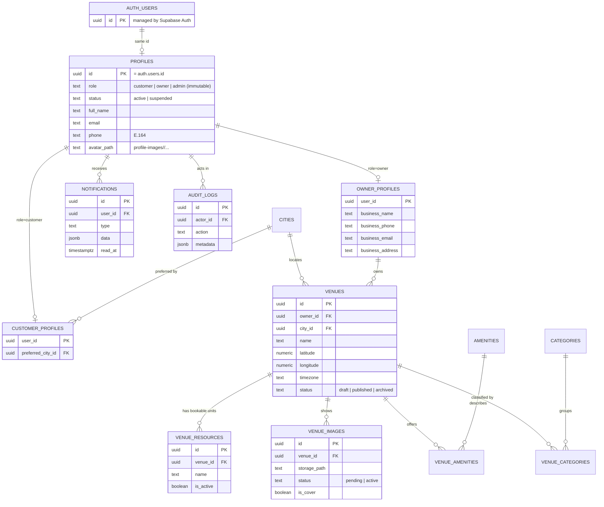

# Database schema (Steps 3–4)

Source of truth: Alembic revisions in `backend/alembic/versions` (`0001` tables, `0002` triggers, `0003` RLS/grants/storage). SQLAlchemy models in `backend/app/models` mirror them (a test fails if they drift). Applied and tested against a throwaway **local PostgreSQL 16 with the Supabase stub**, not against a hosted Supabase project (see STEP_3_REPORT.md).

## Entity relationship diagram

## Tables (25)

| Table | Purpose | Key constraints |
|---|---|---|
| `profiles` | One row per account; **authoritative role and status** (decision D-11) | PK = `auth.users.id` (FK, RESTRICT); role ∈ customer/owner/admin; status ∈ active/suspended; name 1–120 chars; phone E.164; `avatar_path` must start with own id; **role immutable** (trigger); `UNIQUE(id, role)` |
| `customer_profiles` | Customer extension | FK `(user_id, role)` → `profiles(id, role)` with `role = 'customer'`: only customer accounts can have a row |
| `owner_profiles` | Owner / business extension | Same pattern with `role = 'owner'`; business name 1–160 |
| `cities` | Reference data | Unique `(lower(name), lower(state), country_code)`; `country_code` upper-case ISO alpha-2 |
| `categories`, `amenities` | Reference data (admin-maintained later, N13) | Unique kebab-case `slug`; name 1–80 |
| `venues` | Listings (**Step 4 adds** `starting_price_paise`, `currency`, `rating_avg`, `rating_count`, see D-40/D-41) | FK to `owner_profiles` (RESTRICT) so only owners own venues; status draft/published/archived; lat/lng in range and both-or-neither; a **published** venue must have a city and coordinates; indexes on owner and on published-by-city |
| `venue_categories`, `venue_amenities` | Many-to-many | Composite PKs; cascade with venue; RESTRICT on reference rows |
| `venue_images` | Image metadata (files live in Storage) | `storage_path` unique and inside `<venue_id>/`; status pending/active; one cover per venue (partial unique index); a cover must be active |
| `venue_resources` | Bookable units inside a venue (courts) | Unique `(venue_id, lower(name))`. **Structural only**, see decisions |
| `favorites` | Customer ↔ venue bookmarks (**Step 4**, migration `0004`) | PK `(customer_id, venue_id)` so a pair exists once; FK to `customer_profiles` (only customers) and `venues`, both CASCADE; indexes on `(customer_id, created_at DESC)` and `venue_id` |
| `schedule_rules` | Weekly opening hours (**Step 5**, migration `0005`) | `weekday` 0–6 (0 = Monday); `opens_at < closes_at`; `UNIQUE(venue_id, weekday, opens_at)`; cascade with venue; local time at the venue (its `timezone`). Hours only: no slot length, courts or pricing (D-53) |
| `schedule_exceptions` | Special dates (**Step 5**) | `UNIQUE(venue_id, on_date)`; closed ⇒ no hours, open ⇒ both hours with `opens_at < closes_at`; note ≤ 200 chars |
| `bookings` | A reservation (**Step 6**, migration `0006`) | Unique `booking_code`; status and payment_status CHECKs; times and duration must agree; amounts ≥ 0; price/name/time-zone snapshots; `expires_at` required while `pending_payment`; unique `(customer_id, idempotency_key)`; FKs `RESTRICT` |
| `booking_slots` | Reserved time per booking (**Step 6**) | `tstzrange`, bounded and non-empty; `EXCLUDE USING gist (resource_id WITH =, slot_range WITH &&) WHERE (is_blocking)` forbids double-booking (needs `btree_gist`) |
| `booking_status_history` | Status audit trail (**Step 6**) | Append-only (update trigger); actor role customer/owner/admin/system |
| `availability_blocks` | Owner temporary unavailability (**Step 6**) | `resource_id` NULL = whole venue; non-empty bounded range |
| `notifications` | In-app notifications (**Step 7 adds** `booking_id`, `payment_id`, `dedupe_key`, `push_status`, `push_attempts`, `push_sent_at`) | `data` must be a JSON object (ids only); `UNIQUE(user_id, dedupe_key)`; partial index on pending pushes |
| `payments` | One Razorpay order/payment per booking (**Step 7**, migration `0007`) | `UNIQUE(booking_id)`, `UNIQUE(provider, provider_order_id)`, partial `UNIQUE(provider, provider_payment_id)`; status CHECK (created, pending, authorized, captured, failed, refunded, partially_refunded); `amount_paise > 0`; captured ⇒ payment id present; `review_required` ⇒ reason; no card data |
| `payment_events` | Append-only record of every gateway signal (**Step 7**) | Partial `UNIQUE(provider_event_id)` = webhook idempotency; update trigger blocks edits; outcome applied/duplicate/ignored/rejected; sanitised `detail` |
| `user_device_tokens` | FCM tokens (**Step 7**) | `UNIQUE(token)`; platform android/ios/web; app customer/owner/admin; no client grant |
| `notification_preferences` | `push_enabled`, `email_enabled` per user (**Step 7**); `booking_enabled`, `payment_enabled`, `promo_enabled` (**Settings**, rev 0010) | PK `user_id`; own row readable |
| `email_deliveries` | Email queue and delivery log (**Step 7**) | `UNIQUE(dedupe_key)`; status queued/sent/failed/skipped; non-secret `context`; no client grant |
| `audit_logs` | Append-only trail | Update/delete blocked by trigger (only the FK nulling `actor_id` is allowed); `actor_role` ∈ customer/owner/admin/system |

All tables use UUID primary keys (`gen_random_uuid()`), `timestamptz` timestamps, and `updated_at` is maintained by a trigger. Money columns (integer paise) exist on `bookings` since Step 6; payments and refunds are Step 7. `venue_resources` gained `slot_minutes` (5–720) and `slot_price_paise` (≥ 0), both NULL until the owner sets them.

## Decisions and deviations from the Step 1 plan

| # | Decision | Why |
|---|---|---|
| D-27 | **No `user_roles`, `user_sessions`, `account_status` or `admin_profiles` tables.** Role and status are columns on `profiles`; sessions are Supabase's (`auth.sessions`); admins are `profiles` with role `admin`. | The brief says "do not create duplicate user tables". The approved architecture assumes one role per account (N10 still open) and shows no admin profile table. A role table can be added by a later migration if N10/Q18 require it. |
| D-28 | `venue_resources` (brief name) is the architecture's `resources`. It has **no price, capacity or schedule**. | Q1, Q2, Q17, N2 and N23 (what is booked, how slots and capacity work) are unanswered blockers. The table only fixes the shape "a venue has bookable units", and the architecture's default (one unit per venue unless Q17 says otherwise) remains possible. |
| D-29 | `venue_categories` is the join table; `categories` is the catalogue (architecture §7). `audit_logs` is the architecture's `admin_audit_logs`, widened to any actor. | Matches the approved ER; the brief's list is ambiguous. |
| D-30 | `cities` was added (it was in the Step 1 plan but not in the brief's list) because `venues.city_id` needs it. No rows are seeded. | N1 (launch geography) and N13 (who maintains master data) are open; no categories, amenities or cities are invented. |
| D-31 | Venue status is `draft / published / archived` only. | Q4 (admin approval) is open; adding `pending_review` later is a one-line CHECK change. |
| D-32 | Venue location is `latitude`/`longitude` numeric columns, not a PostGIS geography. | Avoids a hard dependency on the `postgis` extension for now; a generated geography column can be added when distance search is built (Step 4). |
| D-33 | `profiles.email` is copied from the verified token at registration and is not editable through the API. | The identity provider owns it. |
| D-39 | `favorites` is keyed by `(customer_id, venue_id)` and has no surrogate id. The API removes by **venue id** (`DELETE /favorites/{venue_id}`), not by a favourite id. | A pair can exist only once, so a surrogate id adds nothing; the brief's `DELETE /favorites/{id}` is read as "the favourited item". |
| D-40 | `venues.starting_price_paise` (nullable, integer paise, ≥ 0) and `currency` (default `INR`) are an **interim, display-only** "from" price, read as **per hour**. | Real pricing lives in `schedule_rules` (architecture §7, built with availability in Step 6). The listing cards need a price now. When schedules exist this column is derived from them. **ASSUMPTIONS to confirm:** per-hour meaning (Q1/Q2/Q17) and INR (N1). |
| D-41 | `rating_avg` (0–5, 1 decimal) and `rating_count` are aggregate columns only. There is no `reviews` table yet, so they stay `NULL` / `0` and the app shows **"New"**, never an invented rating. A CHECK forbids a count without an average. | Reviews are a later step. No fabricated social proof. |
| D-34 | A "published venue needs a city and coordinates" CHECK exists. | Data-quality guard (the apps need a location to show a venue); not a business rule about who may publish. Remove if the product decides otherwise. |

## RLS summary

All 27 tables have RLS enabled (Step 7: `payments` readable by its customer, the venue's owner and admins; `notification_preferences` by its user; `payment_events`, `user_device_tokens` and `email_deliveries` by nobody but the backend) (Step 6 added 4 tables and 7 more `SELECT` policies; before that 23 `SELECT` policies on `public`; the two schedule tables are readable only for venues the caller can already see; `favorites_select_own` = own rows, customers only). `anon` and `authenticated` hold `SELECT` only (writes are revoked) and the only policies are `SELECT` policies; **there are no insert/update/delete policies**, so even a mistaken GRANT cannot allow a client write (tested both ways). See ROLE_PERMISSION_MATRIX.md for who sees what.

## Not in this schema yet

Refunds, ledger, payouts (no approved policy: Q9, Q10), reviews. Added by the steps that need them. Jobs are an in-process loop plus the `notifications`/`email_deliveries` outbox, not a table.

## Step 10 additions (migration 0009; 0008 added indexes only)

- `reviews`: one per booking (`UNIQUE booking_id`), `rating` 1-5, optional `comment` (1-1000 chars). Trigger `trg_reviews_rating` recomputes `venues.rating_avg/rating_count` after locking the venue row. Update and delete are refused by trigger.
- `review_responses`: one per review (`UNIQUE review_id`), `body` 1-1000 chars; immutable.
- RLS enabled and all client grants revoked: reads happen only through the API.
- Migration 0008: indexes `bookings(created_at DESC)`, `profiles(role, created_at DESC)`, `venues(created_at DESC)`.

## SQL Editor package (`supabase/`)

`supabase/migrations/001…010_*.sql` plus `supabase/seed.sql` build this same schema (Alembic head `0009`) without Alembic, for the Supabase SQL Editor. Alembic stays the source of truth; `supabase/verify_sync.sh` proves the two are identical. Instructions: `supabase/README.md`.

## Settings additions (revision 0010 / `supabase/migrations/011_settings.sql`)

No existing table was duplicated; existing tables were extended:

| Table | Change |
|---|---|
| `profiles` | `language` (`en`/`hi`, default `en`), `deletion_requested_at` (set while an account-deletion request is open) |
| `customer_profiles` | `preferred_category_ids uuid[]` (sports interests, max 20, validated against `categories` by the API) |
| `notification_preferences` | `booking_enabled`, `payment_enabled`, `promo_enabled` (default true) |
| `support_tickets` (**new**, the only new table) | `user_id`, `kind` (`support`/`feedback`/`issue`), `subject`, `message`, `app_version`, `platform`, `status` (`open`/`closed`); RLS on, all client grants revoked (API only) |

## Commission management (migration 0012)

`commission_rules`, `commission_rule_versions` (append-only history) and `booking_commission_snapshots` (immutable per booking); `ledger_entries` gained `commission_bps`, `commission_scope`, `commission_rule_id`, `commission_rule_version`, `commission_base_paise`; `finance_configs` gained `commission_base`. All new tables have RLS enabled with no API-role grants. Details and rules: [COMMISSION_MANAGEMENT.md](COMMISSION_MANAGEMENT.md).
