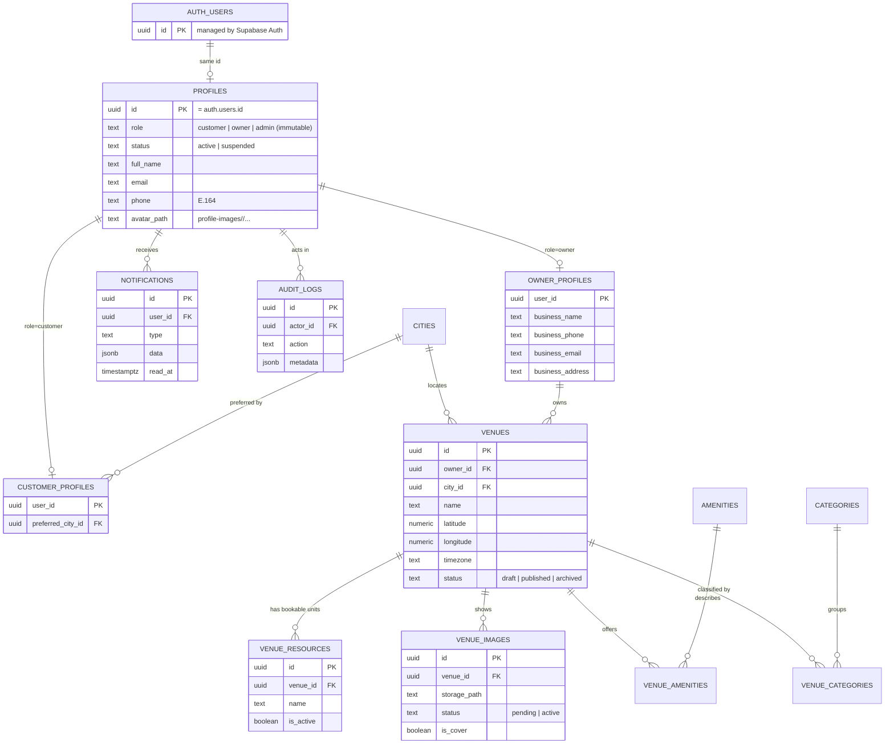

# Database schema (Steps 3–4)

Source of truth: Alembic revisions in `backend/alembic/versions` (`0001` tables, `0002` triggers, `0003` RLS/grants/storage). SQLAlchemy models in `backend/app/models` mirror them (a test fails if they drift). Applied and tested against a throwaway **local PostgreSQL 16 with the Supabase stub**, not against a hosted Supabase project (see STEP_3_REPORT.md).

## Entity relationship diagram

## Tables (14)

| Table | Purpose | Key constraints |
|---|---|---|
| `profiles` | One row per account; **authoritative role and status** (decision D-11) | PK = `auth.users.id` (FK, RESTRICT); role ∈ customer/owner/admin; status ∈ active/suspended; name 1–120 chars; phone E.164; `avatar_path` must start with own id; **role immutable** (trigger); `UNIQUE(id, role)` |
| `customer_profiles` | Customer extension | FK `(user_id, role)` → `profiles(id, role)` with `role = 'customer'`: only customer accounts can have a row |
| `owner_profiles` | Owner / business extension | Same pattern with `role = 'owner'`; business name 1–160 |
| `cities` | Reference data | Unique `(lower(name), lower(state), country_code)`; `country_code` upper-case ISO alpha-2 |
| `categories`, `amenities` | Reference data (admin-maintained later, N13) | Unique kebab-case `slug`; name 1–80 |
| `venues` | Listings (**Step 4 adds** `starting_price_paise`, `currency`, `rating_avg`, `rating_count`, see D-40/D-41) | FK to `owner_profiles` (RESTRICT) so only owners own venues; status draft/published/archived; lat/lng in range and both-or-neither; a **published** venue must have a city and coordinates; indexes on owner and on published-by-city |
| `venue_categories`, `venue_amenities` | Many-to-many | Composite PKs; cascade with venue; RESTRICT on reference rows |
| `venue_images` | Image metadata (files live in Storage) | `storage_path` unique and inside `<venue_id>/`; status pending/active; one cover per venue (partial unique index); a cover must be active |
| `venue_resources` | Bookable units inside a venue (courts) | Unique `(venue_id, lower(name))`. **Structural only**, see decisions |
| `favorites` | Customer ↔ venue bookmarks (**Step 4**, migration `0004`) | PK `(customer_id, venue_id)` so a pair exists once; FK to `customer_profiles` (only customers) and `venues`, both CASCADE; indexes on `(customer_id, created_at DESC)` and `venue_id` |
| `notifications` | In-app notifications | `data` must be a JSON object; indexes for list and unread |
| `audit_logs` | Append-only trail | Update/delete blocked by trigger (only the FK nulling `actor_id` is allowed); `actor_role` ∈ customer/owner/admin/system |

All tables use UUID primary keys (`gen_random_uuid()`), `timestamptz` timestamps, and `updated_at` is maintained by a trigger. Money columns do not exist yet (bookings and payments are later steps).

## Decisions and deviations from the Step 1 plan

| # | Decision | Why |
|---|---|---|
| D-27 | **No `user_roles`, `user_sessions`, `account_status` or `admin_profiles` tables.** Role and status are columns on `profiles`; sessions are Supabase's (`auth.sessions`); admins are `profiles` with role `admin`. | The brief says "do not create duplicate user tables". The approved architecture assumes one role per account (N10 still open) and shows no admin profile table. A role table can be added by a later migration if N10/Q18 require it. |
| D-28 | `venue_resources` (brief name) is the architecture's `resources`. It has **no price, capacity or schedule**. | Q1, Q2, Q17, N2 and N23 (what is booked, how slots and capacity work) are unanswered blockers. The table only fixes the shape "a venue has bookable units", and the architecture's default (one unit per venue unless Q17 says otherwise) remains possible. |
| D-29 | `venue_categories` is the join table; `categories` is the catalogue (architecture §7). `audit_logs` is the architecture's `admin_audit_logs`, widened to any actor. | Matches the approved ER; the brief's list is ambiguous. |
| D-30 | `cities` was added (it was in the Step 1 plan but not in the brief's list) because `venues.city_id` needs it. No rows are seeded. | N1 (launch geography) and N13 (who maintains master data) are open; no categories, amenities or cities are invented. |
| D-31 | Venue status is `draft / published / archived` only. | Q4 (admin approval) is open; adding `pending_review` later is a one-line CHECK change. |
| D-32 | Venue location is `latitude`/`longitude` numeric columns, not a PostGIS geography. | Avoids a hard dependency on the `postgis` extension for now; a generated geography column can be added when distance search is built (Step 4). |
| D-33 | `profiles.email` is copied from the verified token at registration and is not editable through the API. | The identity provider owns it. |
| D-39 | `favorites` is keyed by `(customer_id, venue_id)` and has no surrogate id. The API removes by **venue id** (`DELETE /favorites/{venue_id}`), not by a favourite id. | A pair can exist only once, so a surrogate id adds nothing; the brief's `DELETE /favorites/{id}` is read as "the favourited item". |
| D-40 | `venues.starting_price_paise` (nullable, integer paise, ≥ 0) and `currency` (default `INR`) are an **interim, display-only** "from" price, read as **per hour**. | Real pricing lives in `schedule_rules` (architecture §7, built with availability in Step 6). The listing cards need a price now. When schedules exist this column is derived from them. **ASSUMPTIONS to confirm:** per-hour meaning (Q1/Q2/Q17) and INR (N1). |
| D-41 | `rating_avg` (0–5, 1 decimal) and `rating_count` are aggregate columns only. There is no `reviews` table yet, so they stay `NULL` / `0` and the app shows **"New"**, never an invented rating. A CHECK forbids a count without an average. | Reviews are a later step. No fabricated social proof. |
| D-34 | A "published venue needs a city and coordinates" CHECK exists. | Data-quality guard (the apps need a location to show a venue); not a business rule about who may publish. Remove if the product decides otherwise. |

## RLS summary

All 14 tables have RLS enabled (21 `SELECT` policies on `public`; `favorites_select_own` = own rows, customers only). `anon` and `authenticated` hold `SELECT` only (writes are revoked) and the only policies are `SELECT` policies; **there are no insert/update/delete policies**, so even a mistaken GRANT cannot allow a client write (tested both ways). See ROLE_PERMISSION_MATRIX.md for who sees what.

## Not in this schema yet

Bookings, slots, payments, refunds, ledger, payouts, reviews, device tokens, schedules, jobs. Added by the steps that need them.
