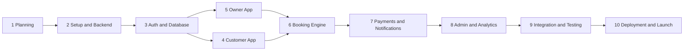

# ZURUV — IMPLEMENTATION ROADMAP (10 Fixed Development Stages)

**Version:** 4.0. Stack: Flutter (Customer and Owner apps) · FastAPI + SQLAlchemy 2.x + Pydantic v2 + Alembic · Supabase (PostgreSQL, Auth, Storage, RLS) · Next.js admin · Razorpay, Google Maps, Firebase Cloud Messaging, Resend. Architecture: `SYSTEM_ARCHITECTURE.md`.

**Working rules**
- The ten stages are fixed in number, name and order.
- Work proceeds one stage at a time. **No stage starts without your explicit approval.** Each stage ends with a completion report.
- A feature is complete only when its UI, API endpoint, database migration, validation and automated tests work together.
- Earlier functionality is never broken: the automated regression suite grows each stage and must stay green.
- Real database integration only; no hardcoded business data, fake metrics or dead buttons; no secrets in Git.
- Unconfirmed business rules (pricing, commission, taxes, refunds, payouts, hold times) are never invented. They live in versioned configuration and in `OPEN_QUESTIONS.md`.

**Source gap:** the quotation PDF, the walkthrough video and any existing repository were not available. Stage 1 is therefore **not complete** (see Stage 1).

Question IDs (Q, N, C, S) refer to `OPEN_QUESTIONS.md`.

---

## Summary

| # | Stage | Main outcome |
|---|---|---|
| 1 | Planning & Architecture | Requirements, architecture, roadmap, open questions, decision gate |
| 2 | Project Setup & Backend | Monorepo, working skeletons for all four codebases, environments, validated architecture |
| 3 | Authentication & Database | Schema, migrations, roles, JWT verification, RLS |
| 4 | Customer App – UI & Discovery | Customer UI through discovery and venue details, favourites, profile |
| 5 | Venue Owner App – UI & Management | Owner UI, venue management, images, pricing, business profile |
| 6 | Availability & Booking Engine | Schedules, slots, holds, no double booking, booking lifecycle |
| 7 | Payments & Notifications | Razorpay, webhooks, confirmation, refunds, ledger, push and email |
| 8 | Admin Dashboard & Analytics | Admin site, analytics, reviews, payouts |
| 9 | Complete Integration & Testing | Cross-interface workflows, security and payment testing, performance |
| 10 | Production Deployment & Launch | Production environments and store releases |

---

## Sequencing proposals that need your approval

Fitting the full requirements into the fixed order exposed five gaps. The stages below are written on these proposals.

| # | Gap | Proposal |
|---|---|---|
| G1 | Features required by the references but not named in any stage: favourites, customer profile, notification screens, reviews, owner earnings and analytics, payouts, bank settings. | Each is placed in the stage where its data exists (see the stage lists). |
| G2 | Stage 4 (Customer App) needs venues, but owners create venues in Stage 5, and fake production data is forbidden. | Stage 4 uses real venues through the real API. In development and staging only, a clearly labelled seed script loads sample venues. Production is never seeded with sample venues. |
| G3 | Stage 4 is "UI & Discovery", yet screens 7–11 (slots, summary, payment, confirmation, My Bookings) depend on Stages 6–7. | Stage 4 delivers working customer screens 1–6, 12 and 13. Screens 7 and 8 are built in Stage 6, 9 and 10 in Stage 7, and 11 across Stages 6 and 7, so no button is ever non-functional. |
| G4 | Confirmed (paid) bookings cannot exist before payments in Stage 7. | Stage 6 builds and tests the booking engine and cancellation rules using a test-only payment simulation that never ships; the full paid journey works at the end of Stage 7. |
| G5 | Money tables depend on unanswered rules (fees, tax, commission, refunds, payouts). | Stage 3 documents the full schema but migrates only identity, catalogue, venue, schedule and booking tables. Payment, refund, ledger and payout tables are migrated in Stages 7–8, after the rules are confirmed. |

The latest context lists neither **Supabase Flutter** nor **Pytest**; both were in the earlier approved stack and are retained (Supabase Flutter is the client for Supabase Auth; Pytest runs the required critical-logic tests). Please confirm.

---

## STAGE 1 — Planning & Architecture

**Objectives**
- Understand the complete product from all four references and the brief.
- Finalise requirements, workflows, architecture, database plan and roadmap, separating confirmed requirements from recommendations.

**Features (work items)**
- Reference analysis: quotation PDF, walkthrough video, Customer board (13 screens), Owner board (14 screens).
- The five documents: `PROJECT_CONTEXT.md`, `REQUIREMENTS_MATRIX.md`, `OPEN_QUESTIONS.md`, `SYSTEM_ARCHITECTURE.md`, `IMPLEMENTATION_ROADMAP.md`, including the initial ER diagram and API catalogue.
- Decision gate and early account setup.

**Dependencies**
- `docs/reference/quotation.pdf` and `docs/reference/app-walkthrough.mp4` (not yet available).
- Design source files or full-resolution assets.
- Confirmation whether a repository exists.

**Deliverables**
- The five documents (delivered, awaiting reconciliation with the missing references).
- Reconciliation note listing every difference between the quotation, video, boards and brief.
- Answers to the decision-gate questions; approved sequencing proposals G1–G5.
- Accounts started now because of lead time: Razorpay merchant onboarding and KYC, Apple Developer and Google Play, SMS provider and Indian sender registration (only if phone login stays), domain and Resend verification, Google Cloud billing and Maps keys, Firebase project and APNs key.

**Testing requirements**
- Every requirement traces to a source and to at least one acceptance criterion.
- Every screen on both boards appears in `PROJECT_CONTEXT.md` and in the matrix.
- Documents are internally consistent (IDs, stage numbers, terminology).

**Completion criteria**
- You approve the documents.
- The quotation and video have been reviewed and reconciled.
- The decision gate is answered or explicitly deferred: S1–S4, Q1, Q2, Q11, Q17, N1, N2, N23, N24, N25.

---

## STAGE 2 — Project Setup & Backend

**Objectives**
- Create the monorepo and working skeletons of all four codebases and the environments they run in.
- Prove the architecture's riskiest assumptions before building on them.

**Features (work items)**
- Monorepo per `SYSTEM_ARCHITECTURE.md` §4 with pinned current stable versions.
- Flutter: Dart pub workspace, Customer and Owner apps, shared packages `zuruv_design`, `zuruv_core`, `zuruv_api`, `zuruv_auth` as shells; flavors dev / staging / prod.
- FastAPI: app factory, typed settings, structured logging, request IDs, error format, `/healthz`, `/readyz`, module folders, provider adapter interfaces with fakes.
- Next.js: App Router, Tailwind, shadcn/ui, Recharts installed.
- Supabase dev and staging projects; Railway and Vercel environments; Docker Compose local database.
- `.env.example` for every component; CI per component with path filters; secret scanning; `Makefile`.
- Design tokens extracted from the boards into `zuruv_design` and the admin Tailwind theme.
- Validation spikes with a short ADR each: pooler and concurrency (S2-1), JWT verification (S2-2), social and phone sign-in (S2-3), Razorpay sandbox including webhook and payout options (S2-4), storage upload and validation (S2-5), Railway deployment (S2-6), Dart DTO approach (S2-7), Alembic with `auth.users` (S2-8).

**Dependencies**
- Stage 1 completion; accounts for GitHub, Supabase, Railway, Vercel; Razorpay sandbox; Firebase project.

**Deliverables**
- Repository with CI passing; apps launch on emulators; API deployed to Railway staging; admin deployed to a Vercel preview; ADRs for each spike; updated architecture if any assumption failed.
- No product features.

**Testing requirements**
- Clean clone builds and tests in CI.
- A deliberately planted fake secret fails CI.
- API health checks pass in staging.
- Spike S2-1: 100 parallel booking attempts on one slot through the chosen database connection give exactly one success.

**Completion criteria**
- All skeletons run locally and in staging; all spikes closed; no open critical architecture risk.

---

## STAGE 3 — Authentication & Database

**Objectives**
- Establish the data model and secure identity so every later feature rests on tested permissions.

**Features (work items)**
- Full schema documented (data dictionary, ER diagram). Migrated now: profiles, customer and owner profiles, device tokens, admin audit logs, cities, categories, amenities, venues, venue images, venue categories and amenities, resources, schedule rules and exceptions, bookings, booking slots with the exclusion constraint, booking status history, favourites, notifications. Designed but migrated later (G5): payments, refunds, ledger, fee and policy configuration, payouts, coupons, reviews.
- SQLAlchemy 2.x models; Alembic migrations; extensions; reference-data seeding; test-only `auth` stub.
- RLS on every application table with no client policies; Supabase data API not exposed.
- JWT verification, role and status from `profiles`, `GET /v1/me`, customer and owner registration, admin creation script, admin MFA enforcement.
- `zuruv_auth` package: sign-in flows, secure session storage, role guards in GoRouter for both apps; admin login page with TOTP.

**Dependencies**
- Stage 2; answers to Q1, Q2, Q11, Q17, N1, N2, N23, N10, N12, N17, N24, N31.

**Deliverables**
- Migrations, models, seed data, ER diagram and data dictionary; authentication working on all three clients; permission matrix implemented and documented.

**Testing requirements**
- Migrations up and down; constraint tests (overlap rejected, non-blocking rows allowed, invalid status rejected).
- RLS test: `anon` and `authenticated` roles read nothing.
- RBAC test across every route; expired, forged and wrong-audience tokens rejected; suspended user blocked with a valid token.
- Customer app rejects an owner account and vice versa; admin without MFA rejected.

**Completion criteria**
- A user can register and sign in on each interface and reach a role-correct empty home; every permission rule is covered by passing tests.

---

## STAGE 4 — Customer App – UI & Discovery

> **Status (2026-11-12): implemented.** Backend verified by 162 passing tests; Flutter code written but **not compiled, analysed or run** (no SDK available) and no screenshots exist. Deviations: distance uses haversine, not PostGIS (D-42); "Today" is shown disabled rather than hidden (D-44); Google Maps / Places is an interface only (D-48); "Book Now" explains that booking is not yet available (D-45). Details and open items: `STEP_4_REPORT.md`.

**Objectives**
- Deliver the customer experience from first launch to venue details using real data and the supplied design.

**Features (work items)**
- Customer screens 1–6, 12 and 13: splash, onboarding, sign-up/login, Home, venue list with filters (Near me, Today, Price, More), venue details, favourites, profile.
- City selector, category browsing, search, favourites, profile editing.
- Google Maps display, location permission flow and distance (PostGIS).
- Reusable `zuruv_design` components; Riverpod, GoRouter shell with bottom navigation, Dio client.
- Backend: catalogue, venue read and search endpoints, favourites, customer profile (endpoints in `SYSTEM_ARCHITECTURE.md` §21).
- Development and staging seed script for sample venues (G2). The "Today" filter is added in Stage 6, when availability exists; until then it is not shown.

**Dependencies**
- Stage 3; Q12, N16, N20; designs for screens not on the board (search, city picker, filter sheets, notifications, help, settings).

**Deliverables**
- Working customer app (screens above) against staging; backend endpoints with tests; component library; accessibility review.

**Testing requirements**
- Filter, sort and pagination correctness; unpublished venues never returned; favourites idempotent; location denied fallback.
- Widget and golden tests for key screens; API integration tests; visual review against the board; every control functional.

**Completion criteria**
- A customer can register, browse real venues, filter, open details and manage favourites and profile; no non-functional controls.

---

## STAGE 5 — Venue Owner App – UI & Management

> **Status (2026-11-12): implemented, with parts waiting on later stages.** Backend verified by 175 passing tests; Flutter code written but **not compiled, analysed or run** (no SDK available) and no screenshots exist. Real and working against the API: auth and role gate, venue CRUD, image upload/cover/reorder/delete, publish/unpublish, weekly and special opening hours, dashboard venue data and ratings, notifications, business profile. Shown honestly as "not available yet": bookings and booking details (Step 6), revenue/earnings/payouts/payments history (Step 7), booking and utilization analytics (Steps 6/7), reviews (no reviews feature), bank details (storage rules undecided). Decisions D-50…D-58 and open items: `STEP_5_REPORT.md`.

**Objectives**
- Let owners create and manage their own venues, which is the supply side of the marketplace.

**Features (work items)**
- Owner screens: splash, onboarding, sign-up/login, dashboard shell, My Venues, Add/Edit Venue, business profile, bottom navigation with the `More` tab.
- Venue create, edit, publish and unpublish with ownership enforcement; categories, amenities, pricing, address and map location picker (Google Places).
- Resources (courts) per Q17; image upload pipeline (signed upload, server validation, re-encoding).
- Owner onboarding data per N11; publish rules per Q4.
- The dashboard shows the real venue overview; KPI tiles are shown as unavailable until Stage 8, not faked.

**Dependencies**
- Stage 3; Q4, N9, N11; designs for owner controls absent from the board (pricing, facilities, amenities, map picker).

**Deliverables**
- Working owner app against staging; venue management endpoints with tests; media module.

**Testing requirements**
- Owner A cannot read or change owner B's data; server rejects invalid input independent of the client.
- Upload security: wrong type, oversize, non-image, spoofed extension.
- Flutter integration tests for create and edit flows; a published venue appears in the Customer app and an unpublished one does not.

**Completion criteria**
- An owner can create, edit, publish and unpublish venues with images, pricing and amenities, and customers see them in the Customer app.

---

## STAGE 6 — Availability & Booking Engine

> **Status (2026-11-12): implemented; payment-dependent parts wait for Stage 7.** Backend verified by 215 passing tests (40 new, including real-thread concurrency tests); Flutter code written but **not compiled, analysed or run** (no SDK available) and no screenshots exist. Built: availability and slot engine, courts with owner-set slot length and price, blocked periods, bookings with idempotent creation, exclusion-constraint double-booking guard, status history, customer cancellation under configurable rules, schedule-change conflict policy, owner/admin booking views, Customer slot picker/summary/My Bookings/cancel, Owner courts/bookings/dashboard counts. **Not built (waiting for a business answer):** fees/GST/commission/coupons (Q7, Q8, N7), refund and paid-booking cancellation (Q9, Q10), owner cancellation (N22), multi-slot or variable-duration bookings (N2), automatic court assignment (N3), capacity/class bookings (N23), the customer "Today" filter on discovery. Confirmation by payment is Stage 7. Decisions D-59…D-68 and open items: `STEP_6_REPORT.md`.

**Objectives**
- Make availability and reservation correct under concurrency; this is the core of the platform.

**Features (work items)**
- Owner Manage Slots (regular hours, special hours, slot duration, pricing); schedule-change impact check (Q16).
- Slot generation from schedules, special-hour overrides and existing bookings in the venue's time zone; availability endpoints; "Today" filter.
- Pricing engine and quote based on versioned configuration (Q7).
- Booking hold transaction with idempotency, lazy hold expiry and sweeper; exclusion-constraint-backed conflict response; booking state machine and history; cancellation evaluation from policy data (Q9).
- Customer screens 7 and 8 (date and slot selection, booking summary); owner incoming bookings and booking details; My Bookings (screen 11) as far as the engine allows.
- Worker service introduced for expiry.

**Dependencies**
- Stages 4 and 5; Q7, Q9, Q11, Q16, N3, N4, N6, N22 (and N7 if coupons are approved).

**Deliverables**
- Slot engine and booking services with tests; availability and booking endpoints; owner and customer screens above; pricing configuration tables.

**Testing requirements**
- Concurrency suite: many parallel requests for one slot yield exactly one success and a defined conflict response for the others.
- Idempotent retries; expired hold reuse; illegal transitions rejected; status consistent across customer, owner and admin endpoints.
- Table-driven schedule tests (hours, overrides, midnight crossing, time zones, booking window); pricing golden tests including rounding.

**Completion criteria**
- A slot shown as available is genuinely available; double booking is impossible under load; holds expire correctly. The paid journey is completed in Stage 7 (G4).

---

## STAGE 7 — Payments & Notifications

> **Status (2026-11-12): implemented, within approved rules.** Backend verified by 268 passing tests using fake gateways with real signature logic; Flutter written but **not compiled, analysed or run**; no real Razorpay, Firebase or Resend call made. Built: order creation, checkout-signature verify, signed webhook with idempotency, reconciliation, payment state machine, customer payment/history screens, owner gross earnings and payment list, FCM token registration and push, Resend emails with delivery log, admin payment APIs. **Not built (waiting for a business answer):** refunds and refund execution (Q9), payouts (Q10), fees/GST (Q7), commission (Q8), coupons (N7), KYC (N11), marketplace (N25), owner cancellation (N22), Add to Calendar. Admin web UI is Step 8. Details: `STEP_7_REPORT.md`.

**Objectives**
- Turn holds into verified, paid bookings, keep money records correct, and keep users informed.

**Features (work items)**
- Migrations for payments, payment events, refunds, ledger, fee and cancellation configuration (G5).
- Payment order creation, Razorpay checkout in the Customer app, verify endpoint, signed webhook with unique event ids, one idempotent confirmation function, failure and retry handling, late payment handling (N5), refunds, reconciliation job.
- Customer screens 9 and 10 (payment, confirmation) and Add to Calendar; confirmation reachable only after verified payment.
- Cancellation with refund execution; owner cancellation if allowed (N22).
- Ledger and owner earnings view, keeping customer payments, platform revenue, owner earnings and payouts distinct.
- Notifications: outbox and worker, FCM push, Resend emails, notification centre in both apps with read and unread state and preferences.

**Dependencies**
- Stage 6; active Razorpay account and confirmed launch country; Q5, Q6, Q7, Q8, Q9, Q14, N5, N15, N25, N30.

**Deliverables**
- End-to-end paid booking journey; payment, refund and ledger services with tests; notification service with templates; deployed to staging in test mode.

**Testing requirements**
- Sandbox end to end; forged, replayed and out-of-order webhooks; duplicate taps and double payment; amount tampering; late payment; refund amounts exactly match policy.
- Ledger balances and reconciles with the gateway; confirmation unreachable before verification.
- Each event produces exactly one notification; push on real Android and iOS devices; email rendering.

**Completion criteria**
- A customer can discover, select a slot, pay, receive a verified confirmation, see the booking, and cancel per policy; the owner sees the booking, earnings and notification.

---

## STAGE 8 — Admin Dashboard & Analytics

**Objectives**
- Give administrators platform-wide visibility and account control, and give owners accurate analytics.

**Features (work items)**
- Admin site: business dashboard, vendor management, customer management, booking management with booking-ID search, analytics, revenue and transaction monitoring, platform monitoring, master-data management (N13), audit log, failed-job and reconciliation views. Responsive layout, Recharts charts.
- Account status management with effects defined by Q18; every admin write audit-logged.
- Allocated here (G1): owner dashboard KPIs and analytics from raw records (definitions per N8), reviews (customer review form, eligibility per Q15, owner responses per N14, rating aggregates), payout records, bank and payout settings and status (Q10).

**Dependencies**
- Stages 6 and 7 data; Q8, Q10, Q15, Q18, N8, N12, N13, N14; admin UI design (none exists).

**Deliverables**
- Complete admin website; analytics endpoints; review and payout features; owner analytics and dashboard KPIs.

**Testing requirements**
- Admin RBAC and mandatory MFA; suspension effects; filters and search.
- Every KPI recomputed independently from raw rows and matched; ledger and payout consistency.
- Review eligibility and one review per booking; Playwright end-to-end tests for admin; Flutter tests for owner analytics and reviews.

**Completion criteria**
- Every admin module and every owner analytics, review and payout view works on real data; no placeholder metrics remain anywhere.

---

## STAGE 9 — Complete Integration & Testing

**Objectives**
- Prove that the three interfaces and the backend work together reliably and securely, and fix what testing finds.

**Features (work items)**
- Cross-interface scenarios: customer books, owner sees it, admin sees the same status; cancellation, refund and payout paths across all three.
- Security review: OWASP checks, dependency audit, RLS and exposed-schema verification, Maps and Firebase key restrictions, secret audit, webhook abuse tests, multi-replica rate-limit behaviour.
- Load tests of availability and booking at the assumed peak (N18); query and index optimisation.
- Full regression of Stages 2–8; accessibility pass; dead-button and error-state audit; backup and restore drill on staging; error-tracking approach per N26.

**Dependencies**
- Stage 8; staging with all integrations in test mode; performance targets (N18).

**Deliverables**
- Test report, defect log with all high-severity items fixed, performance report, security report, updated runbooks.

**Testing requirements**
- Complete automated regression; end-to-end journeys on real Android and iOS devices; failure injection (webhook delay, gateway timeout, database reconnect); penetration-style tests of authentication, booking and payment.

**Completion criteria**
- No open high-severity defects; performance targets met; the three business workflows pass end to end on staging.

---

## STAGE 10 — Production Deployment & Launch

**Objectives**
- Run ZURUV in production and release both mobile apps.

**Features (work items)**
- Production Supabase (paid plan, backups, Auth providers, Resend SMTP, buckets, schemas not exposed); Railway `api` and `worker`; Vercel admin with production domain; production secrets; rehearsed migrations; production admin account created by script.
- Razorpay live-mode checklist with a small real payment and refund; webhook registered.
- Android and iOS release builds, signing, privacy forms, store listings, Sign in with Apple compliance, account-deletion path if required; internal testing track and TestFlight, then staged rollout.
- Monitoring, alerts (dead jobs, webhook failures, error rate), runbooks (incident, webhook failure, refund, payout), rollback rehearsal.

**Dependencies**
- Stage 9 passed; approved store accounts; Terms, Privacy and refund policy documents (N20); compliance review (N17); domains (N30); live Razorpay account.

**Deliverables**
- Live production system, released or submitted apps, operations runbooks, launch report.

**Testing requirements**
- Production smoke test of every workflow; rollback rehearsal; backup restore verification; live payment and refund test.

**Completion criteria**
- Production is live and monitored; both apps are released or in store review; the launch report is delivered and approved.

---

## Definition of done (every feature, every stage)
1. UI built with loading, empty, error and success states, matching the board or a documented deviation.
2. API endpoint with server-side validation and authorisation.
3. Alembic migration and constraints.
4. Automated tests, including negative and permission cases, passing together with all earlier suites.
5. OpenAPI snapshot, documentation and environment-variable list updated.
6. No hardcoded business data, fake metrics or dead buttons.
7. Acceptance criteria in `REQUIREMENTS_MATRIX.md` verified.

## Principal risks
| Risk | Mitigation |
|---|---|
| Phone OTP needs an SMS provider outside the approved stack, with registration lead time | Decide N24 in Stage 1; start registration early or defer phone login |
| Razorpay country, marketplace and payout suitability unconfirmed | Spike S2-4; adapter boundary; confirm N25, Q8, Q10 early |
| Supabase pooler behaviour with async driver and constraints | Spike S2-1 before schema work |
| Unconfirmed rules stall Stages 6–8 | Stage 1 gate; money tables migrated only after answers; versioned configuration |
| Fixed stage order separates UI from backend (G2–G4) | Proposals above; no screen ships before its backend exists |
| Missing designs (admin, many sub-screens) | Design pass before Stages 4, 5 and 8 |
| Missing source files (quotation, video) | Resolve before Stage 1 closes |
| Store review and account approval delays | Open accounts in Stage 1; early internal tracks |
| Per-instance rate limiting is weaker across replicas | Idempotency and database constraints; test in Stage 9 |
| Production on a free Supabase tier | Paid plan required for production **[Verify limits]** |
