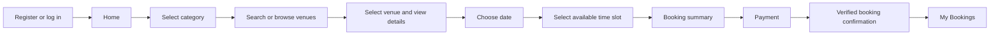
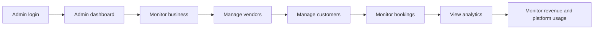

# ZURUV — PROJECT CONTEXT

**Tagline:** Discover. Book. Play.
**Status (updated Step 7):** Stages 1–6 delivered; **Stage 7 (payments and notifications) implemented 2026-11-12**, backend verified by 268 tests, Flutter written but not compiled; no real Razorpay/Firebase/Resend call has been made (see `STEP_7_REPORT.md`). Stage 8 has not started and needs your explicit approval.

**Earlier status (Step 6):** Stage 6 (availability and booking engine) implemented 2026-11-12, backend verified by 215 tests (see `STEP_6_REPORT.md`).

**Earlier status:** Stages 1–3 delivered. **Stage 4 (Customer app: UI & discovery) implemented 2026-11-12**: backend verified (162 tests), Flutter code written but **not yet compiled or run** (no SDK in the build environment). Stage 5 has not started and needs your explicit approval. See `STEP_4_REPORT.md`.
**Document set:** `PROJECT_CONTEXT.md` · `REQUIREMENTS_MATRIX.md` · `OPEN_QUESTIONS.md` · `SYSTEM_ARCHITECTURE.md` · `IMPLEMENTATION_ROADMAP.md`

---

## 0. Source status (read first)

| Source | Status | Notes |
|---|---|---|
| Master project brief | **Reviewed** | Primary written specification. Cited as `Brief §n`. |
| Customer UI board (13 screens) | **Reviewed** | Cited as `C-S1 … C-S13`. |
| Owner UI board (14 screens) | **Reviewed** | Cited as `O-S1 … O-S14`. |
| `docs/reference/quotation.pdf` | **NOT reviewed — not available** | Initial business scope. Every requirement below that the brief attributes to the quotation is unverified against it. |
| `docs/reference/app-walkthrough.mp4` | **NOT reviewed — not available** | Behavioural detail (transitions, edge cases, states) is therefore missing. |
| Existing repository | **None supplied** | No code, configs or technical requirements were available. The technology stack is client-approved (see §10); `SYSTEM_ARCHITECTURE.md` is a fresh architecture, not a continuation of existing work. |

**Action required:** supply the quotation PDF, the walkthrough video and the repository (or confirm it is greenfield) so the documents can be reconciled. Items most likely to change are tagged `[verify vs quotation]` or `[verify vs video]` in the other documents.

---

## 1. Product overview

ZURUV is a two-sided marketplace for booking sports, fitness and leisure venues.

- **Customers** discover venues, check real availability, pay and hold a confirmed booking.
- **Venue owners (vendors)** list and manage their own venues, schedules, bookings and earnings.
- **Administrators** monitor and manage the whole platform from a web dashboard.

Three interfaces, one shared backend and database:

1. Customer mobile app
2. Venue Owner mobile app
3. Admin web dashboard

Whether (1) and (2) ship as two apps or one role-based app is undecided (Open Question Q3; recommendation in the architecture document).

**Guiding principles from the brief**
- Commercial product, not a demo. Reliability of booking, availability and money flows outranks screen polish.
- Never invent features, cancellation periods, refund percentages, commission rates, payout timing or payment-hold durations.
- Reference images set visual direction; the video sets behaviour; the quotation sets business scope. Conflicts are documented, not silently merged.
- A feature is done only when frontend, backend, database, validation and tests work together.

---

### 1.1 Project objectives

1. Connect customers with sports, fitness and leisure venues through a single, reliable booking platform (**confirmed**, Brief §1).
2. Give venue owners full control of their own listings, schedules, bookings and earnings (**confirmed**, Brief §3B).
3. Give administrators platform-wide monitoring and account management without ownership of vendor listings (**confirmed**, Brief §3C).
4. Make booking correct before making it attractive: only genuinely available slots are shown and no slot can be double-booked (**confirmed**, Brief §10).
5. Keep customer payments, platform revenue, owner earnings and payouts distinct and auditable (**confirmed**, Brief §5 S10).
6. Present a premium, consistent, mobile-first experience that follows the supplied Customer and Owner UI references (**confirmed**, Brief §8).
7. Run as a secure, scalable, maintainable commercial product on one shared backend and database (**confirmed**, Brief §11–12).
8. Never invent commercial rules; unconfirmed rules are documented and configurable (**confirmed**, Brief §10, §13).

**Confirmed vs proposed in these documents:** statements tagged *Confirmed* come from the brief or the UI boards. Anything I recommend beyond them is tagged *Proposed* or *Recommendation* and is not scope until you approve it.

---

## 2. User roles

### 2.1 Customer
Register/log in; browse sports and activities; search, filter and compare venues; view venue details; check availability; pick date and slot; review charges; pay; receive confirmation; view booking history; cancel per final policy; save favourites; manage profile; receive notifications. (Brief §3A)

### 2.2 Venue owner / vendor
Register/log in; create, publish, edit and manage **own** venues (photos, name, description, categories, location, pricing, facilities, amenities); regular and special operating hours; manage bookable slots; view incoming bookings and booking customers; monitor statuses; track earnings and payments; analytics; view and respond to reviews; notifications; business profile; bank and payout information. A single owner may manage multiple venues. (Brief §3B, O-S5)

**Business rule:** owners create, publish, update and manage their own listings. Admin does platform-level monitoring and account management, **not** listing creation or ownership. Any listing moderation/approval is a *pending decision* (Q4), even though the Owner board shows a "Pending" venue status (see conflict C1).

### 2.3 Admin
Web dashboard: business dashboard, platform activity, vendor management, customer management, booking management and status monitoring, analytics, revenue and transaction monitoring, platform usage, account management. (Brief §3C, §6)

---

## 3. Functional requirements (summary)

Detailed, testable form is in `REQUIREMENTS_MATRIX.md`. Summary by domain:

- **Identity & access:** Google, Apple, Phone, Email sign-in for customers and owners; role-based access control; separate admin login; protected admin operations.
- **Discovery:** categories, search, filters (Near Me, Today, Price, More), venue list and detail, favourites, city selector.
- **Venue management (owner):** CRUD venues, images, categories, amenities, pricing, regular hours, special hours, slot configuration.
- **Availability & booking engine:** slot generation from schedules, conflict-free reservation, temporary holds (if approved), pricing calculation, confirmation only after verified payment, cancellation per policy.
- **Payments & money:** provider-based payment, webhook verification, duplicate protection; customer payments, platform revenue, owner earnings and payouts kept as separate financial concepts.
- **Engagement:** reviews and ratings, owner responses, notifications with read/unread history.
- **Analytics:** owner dashboard and analytics computed from real records; admin platform analytics.
- **Admin:** vendor, customer and booking management; monitoring; account status control.
- **Cross-cutting:** server-side validation, secure uploads, logging, error handling, tests, documented environment variables, no secrets in Git.

---

### 3.1 Application modules

| Application | Modules |
|---|---|
| **Customer app** (Flutter) | Onboarding and authentication · Home and categories · Search and filters · Venue list · Venue details · Date and slot selection · Booking summary · Payment · Booking confirmation · My Bookings and cancellation · Favourites · Profile (payment methods, notifications, help, settings) |
| **Owner app** (Flutter) | Onboarding and authentication · Dashboard · My Venues · Add/Edit Venue (images, categories, amenities, pricing, location) · Manage Slots (regular and special hours) · Incoming Bookings and Booking Details · Payments and Earnings · Analytics · Reviews · Notifications · Profile and Settings (business, bank, payout) |
| **Admin web** (Next.js) | Business Dashboard · Vendor Management · Customer Management · Booking Management · Business Analytics · Platform Monitoring |
| **Backend** (FastAPI, shared) | Authentication and roles · Customers and owners · Catalogue (cities, categories, amenities) · Venues and media · Schedules · Availability · Pricing · Bookings · Payments and refunds · Ledger and payouts · Reviews and favourites · Notifications · Analytics · Admin and audit |
| **Platform services** | Supabase (database, authentication, storage) · Razorpay · Google Maps and Places · Firebase Cloud Messaging · Resend |

Module boundaries in code are defined in `SYSTEM_ARCHITECTURE.md` §4 and §6.

---

## 4. Screen-by-screen breakdown

### 4.1 Customer app (13 screens, `C-S1…C-S13`)

| # | Screen | Elements (from brief + board) | Board observations / gaps |
|---|---|---|---|
| 1 | Splash | Logo, premium sports background, tagline "Play More. Live Better." | Purple-gradient athletes photo. |
| 2 | Onboarding | Intro copy "Your City. More to Play.", sports imagery, Get Started, Skip, page dots | Multi-page carousel implied by dots; only page 1 shown. |
| 3 | Sign up / Login | Google, Apple, Phone, "Use Email Instead", Terms & Privacy link | OTP, email-verification and account-linking flows not designed. |
| 4 | Home | City selector (Bengaluru), search, notification bell, 8 category tiles (Badminton, Tennis, Swimming, Gym, Yoga, Cricket, Football, More), "Popular Near You" cards with rating and ₹/hour, bottom nav (Home, Bookings, Favorites, Profile) | Search results, city picker, "More" categories and notification list screens **not designed**. |
| 5 | Venue list | Title by category ("Badminton Courts"), chips Near me / Today / Price / More, cards with photo, name, area, rating (count), ₹/hour, heart | Filter sheets and sort not designed. |
| 6 | Venue details | Hero photo, back/favourite/share, name, rating (count), area, distance (2.4 km), amenity icons (Parking, Shower, Equipment, Cafe), About / Amenities / Reviews tabs, description, ₹/hour, **Select Slot** | Share action is on the board but not in the brief (see C9). Reviews tab content not shown. |
| 7 | Select date & time | Month header, horizontal date strip, "Available Slots" grid of hourly slots (6:00 AM–10:00 PM shown), selected-slot summary, Continue | Grid lists start times only, jumps from 11:00 AM to 5:00 PM, omits 8:00 PM and shows 9:00 PM twice (likely a mock-up error, or unavailable slots are hidden — see OPEN_QUESTIONS C15). Disabled/booked slot styling not shown. Single-slot selection only. Mock dates (Oct 2026) are in the past — illustrative. |
| 8 | Booking summary | Venue, date, time (1 hour), Court Charges ₹400, Platform Fee ₹20, GST (18%) ₹76, Total ₹496, Apply Coupon, Proceed to Payment | **Illustrative values only — must not be hardcoded** (Brief §4 Screen 8). |
| 9 | Payment | Total, UPI (GPay, PhonePe…), Credit/Debit, Net Banking, Wallet (if available), security note, Pay ₹496 | Provider UI, failure and retry states not designed. |
| 10 | Booking confirmed | Success check, venue, date/time, Booking ID (format `ZRV123456`), View Booking, Add to Calendar | Shown **only** after verified payment + confirmed booking. |
| 11 | My Bookings | Tabs Upcoming / Past, cards with venue, date, time, ID, View Details, Cancel | Cancel eligibility/refund UX depends on policy (Q9). Booking-detail screen not designed. |
| 12 | Favorites | Saved venue list with rating, area, filled hearts | Remove = un-heart. |
| 13 | Profile | Avatar, name, phone, email; My Bookings, My Favorites, Payment Methods, Notifications, Help & Support, Settings | Sub-screens (payment methods, notifications, support, settings, edit profile) **not designed**. |

### 4.2 Owner app (14 screens, `O-S1…O-S14`)

| # | Screen | Elements | Board observations / gaps |
|---|---|---|---|
| 1 | Splash | Logo, tagline "More Players. More Possibilities." | |
| 2 | Onboarding | "List Your Venue. Reach More Players.", benefits copy, Get Started, Skip | Brief lists five benefit points; board shows one page. |
| 3 | Sign up / Login | "Create Your Owner Account", Google / Apple / Phone / Email | Owner KYC/verification not designed. |
| 4 | Dashboard | Period selector (This Month); KPI tiles: Total Revenue ₹48,500, Total Bookings 128, Avg Utilization 86%, Avg Rating 4.8; "My Venues" card (48 bookings, ₹18,500, 92% utilization); bell; bottom nav Dashboard / Venues / Bookings / Payments / More | "Monthly performance" chart from brief is not visibly on the board. Numbers illustrative. |
| 5 | My Venues | Search, "+ Add Venue", cards with photo, name, area, status chip (Active / **Pending**), rating | Pending status → conflict C1. |
| 6 | Add / Edit venue | Change photo, Venue Name, Category icons (Badminton, Tennis, Swimming, Gym, More), Address, Description, Save Venue | Brief also requires location, facilities, amenities, pricing — **not visible on board** (C4). |
| 7 | Manage slots | Tabs Regular Hours / Special Hours; "Set Playing Slots" Mon–Sun with `6:00 AM – 11:00 PM` and "+"; Save Schedule | Slot duration and pricing not visible; Special Hours tab not shown. |
| 8 | Incoming bookings | Tabs Upcoming / Past / Cancelled; rows with date, time, customer, "1 Court • 1 hour", status chip | Implies court/resource concept and multi-court bookings (C2). |
| 9 | Booking details | Status, Booking ID, customer name/phone/email, date, time (1 hour), "1 Court (Court 1)", Total ₹400, Payment Status, Booked On, Contact Customer, Cancel Booking | Owner-initiated cancel not in brief (C12). Total ₹400 vs customer paid ₹496 (C6). |
| 10 | Payments / earnings | Period selector, Total Earnings ₹48,500, bar chart, per-booking rows with Paid chips | Payout info not visible on this board. |
| 11 | Analytics | Bookings 128 (+12%), Revenue ₹48,500 (+16%), Utilization 86% line chart (W1–W4), Top Time Slots with % bars | Date-range filter shown as This Month only. |
| 12 | Reviews | Rating-filter chips (All 120, 5★ 80, 4★ 28, 3★ 8), review cards with name, stars, date, comment | **No owner-reply UI visible**, though brief requires responses. |
| 13 | Notifications | Filter chips All / Bookings / Payments / Reviews; items: new booking, payment received, new review, booking cancelled, payout initiated | Read/unread styling to be defined. |
| 14 | Profile & settings | Avatar, business name, "Owner Account"; Business Information, Bank Account Details, Payout Settings, Notification Preferences, Help & Support, Terms & Policies, Log Out | All sub-screens not designed; financial data protection required. |

Owner bottom navigation has **five** tabs (Dashboard, Venues, Bookings, Payments, More). Analytics, Reviews, Notifications and Profile are assumed to live under **More** (interpretation — confirm).

### 4.3 Admin web dashboard
No design board exists. Modules per Brief §6: Business Dashboard, Vendor Management, Customer Management, Booking Management, Business Analytics, Platform Monitoring. To be designed in the ZURUV visual language.

---

## 5. Main user journeys (core business workflows)

These are the journeys given in the brief (Brief §7).

**Customer journey**

**Venue owner journey**

**Admin journey**

Publishing in the owner journey is subject to the venue-approval decision (Q4). Moving through "Payment" to "Verified booking confirmation" is subject to the payment, fee, tax and cancellation decisions (Q5, Q7, Q9).

---

## 6. Design system summary

- Primary: vibrant violet/purple. Background: clean white. Cards and buttons rounded. Minimal consistent icons. Bottom navigation on core mobile screens. High-quality sports photography.
- Mobile-first; accessible typography; defined loading, empty, success and error states for every screen.
- Both boards use a deep indigo/purple primary on white with green court photography and green success accents. Exact hex values must be sampled from the source image files (the boards supplied are compressed screenshots) and recorded as design tokens during Stage 2.
- The Customer and Owner boards are visually consistent. Any difference found against the video must be documented rather than blended.

---

## 7. Booking engine — non-negotiables (Brief §10)

Only genuinely available slots shown · existing bookings block conflicts · no double reservation of one resource/time · regular hours respected · special hours override per defined rules · consistent duration and pricing calculation · defined change/cancel rules · identical status across customer, owner and admin views. Design decisions (slot generation, concurrency, confirmation, payment verification, hold expiry, cancellation/refund) are in `SYSTEM_ARCHITECTURE.md` §6 with their dependencies on open business decisions.

---

## 8. Security and quality baseline (Brief §11–12, §15)

RBAC; secure auth; server-side validation for every business rule; protected admin operations; secure image uploads; verified payment webhooks; duplicate-booking and duplicate-payment protection; secrets only in environment/secret manager; database access policies; logging; input sanitisation; critical-path tests; reusable components; no hardcoded business data, fake metrics or dead buttons.

---

## 9. Unconfirmed decisions

18 decisions from the brief plus additional ones surfaced from the boards are tracked in `OPEN_QUESTIONS.md`. The decision gate at the end of Stage 1 in the roadmap works as follows: items marked **Blocker** must be answered before the step that depends on them.

---

## 10. Final technology stack (from the master context)

| Area | Technology |
|---|---|
| Mobile | Flutter, Dart, Riverpod, GoRouter, Dio (Supabase Flutter as the Supabase Auth client) |
| Backend | Python, FastAPI, SQLAlchemy 2.x, Pydantic v2, Alembic (Pytest for tests) |
| Database | Supabase PostgreSQL, Supabase Auth, Supabase Storage, RLS |
| Admin | Next.js, TypeScript, Tailwind CSS, shadcn/ui, Recharts |
| Integrations | Razorpay (pending launch country and requirements), Google Maps and Places, Firebase Cloud Messaging, Resend |
| Deployment | Railway (FastAPI), Vercel (Admin), Supabase Cloud, Google Play and App Store |

Detail, rationale and the decision log: `SYSTEM_ARCHITECTURE.md`. Note: the latest master context omits Supabase Flutter and Pytest from its lists, though both were in the earlier approved stack; both are retained pending your confirmation.

## 11. Fixed development roadmap (10 stages)

1 Planning & Architecture · 2 Project Setup & Backend · 3 Authentication & Database · 4 Customer App · 5 Venue Owner App · 6 Availability & Booking Engine · 7 Payments & Notifications · 8 Admin Dashboard & Analytics · 9 Integration & Testing · 10 Deployment & Launch.

The roadmap is fixed. Work on each stage starts only on your explicit instruction. Feature allocation and five sequencing gaps (G1–G5) that need your confirmation are in `IMPLEMENTATION_ROADMAP.md` §1–§2.

## 12. Standing development rules

Build one stage at a time; real database integration only; every button and feature works; modular, reusable, clean-architecture code; all APIs and role permissions secured; no duplicate bookings or payment processing; no hardcoded secrets; tests for critical business logic; documentation maintained; earlier functionality never broken; each stage tested before the next begins; business rules never invented — unconfirmed rules live in `OPEN_QUESTIONS.md`. This document is kept current throughout development.

## 13. Implementation status (kept current)

| Stage | State | Report |
|---|---|---|
| 2 Project setup and backend | Done | `STEP_2_REPORT.md` |
| 3 Authentication and database | Done; Supabase project, real sign-in methods and Flutter code not yet tested | `STEP_3_REPORT.md` |
| 4 Customer app: UI and discovery | Backend done and tested; Flutter written, **not compiled / analysed / run**; no screenshots | `STEP_4_REPORT.md` |
| 5 Owner app: UI and venue management | Backend done and tested (175 tests); Flutter written, **not compiled / analysed / run**; no screenshots; bookings, earnings, reviews and booking analytics wait on Steps 6/7 | `STEP_5_REPORT.md`, `OWNER_APP.md`, `OWNER_API_INTEGRATION.md` |
| 6 Availability and booking engine | Backend done and tested (215 tests); Flutter not compiled | `STEP_6_REPORT.md` |
| 7 Payments and notifications | Backend done and tested with fakes (268 tests); Flutter written, **not compiled / run**; no real Razorpay/FCM/Resend call made | `STEP_7_REPORT.md`, `PAYMENT_ARCHITECTURE.md` |
| 8–10 | Not started | n/a |

**Stage 4 facts a later stage needs.** Customer app is feature-based under `apps/customer_app/lib/{core,features,shared}`; one Dio client (`flutter_shared`), Riverpod, GoRouter with a `StatefulShellRoute` (Home, Explore, Bookings, Favorites, Profile). API additions: `/cities`, `/categories`, `/amenities`, `/venues`, `/venues/{id}`, `/favorites`. Schema additions (migration `0004`): `favorites`; `venues.starting_price_paise`, `currency`, `rating_avg`, `rating_count`. Interim display price and rating aggregates are placeholders until schedules (Stage 6) and reviews exist (D-40, D-41). Distance is haversine (D-42). Reference data and dev-only demo venues come from `backend/scripts/seed_*.py`. Placeholders awaiting later stages: My Bookings, Notifications, "Today" filter, "Book Now", Google Places.

**Stage 5 facts a later stage needs.** Owner app is feature-based under `apps/owner_app/lib/{core,features,shared}` with the same stack and shell pattern as the Customer app (tabs: Dashboard, Venues, Bookings, Earnings, Profile). Owner API (all `OwnerUser`, ownership enforced in the service, other owners' resources return 404): `/owners/venues` (CRUD, `/publish`, `/unpublish`, multipart `/images`, `PUT /images/order`, `PATCH/DELETE /images/{id}`, `GET/PUT /schedules`), `/owners/dashboard`, `/owners/analytics`, `/owners/notifications` (+ `/read`, `/read-all`), and endpoints that answer `available:false` with `depends_on` until their data exists: `/owners/bookings`, `/owners/bookings/{id}` (404), `/owners/earnings`, `/owners/reviews`. Schema additions (migration `0005`): `schedule_rules` (weekday 0=Mon, open interval, local venue time) and `schedule_exceptions` (closed date or custom hours). Images are validated by magic bytes and written to the public-read `venue-images` bucket by the backend with the service-role key (never in a client); `StorageGateway` is injectable (`app.state.storage`). **Step 6 must** replace the interim hours-only model with slot length, courts and pricing once Q1/Q2/Q17/N2/N23 are answered, and fill the `Unavailable` fields the dashboard, analytics, bookings and earnings endpoints already expose, so the Owner app lights up without client changes.

**Stage 6 facts a later stage needs.** Migration `0006`; tables `bookings`, `booking_slots` (GiST exclusion constraint = the double-booking guard), `booking_status_history`, `availability_blocks`; `venue_resources.slot_minutes/slot_price_paise`. Slots are generated on demand by `app/domain/slot_engine.py` (never stored, never computed in Flutter). Booking creation (`BookingService.create`) is one transaction: idempotency replay, stale-hold expiry, venue-row `FOR SHARE`, revalidation, insert, history, audit; owner edits take `FOR UPDATE`; changes that would invalidate a future booking are refused (`SCHEDULE_CONFLICT`, Q16 default). **Every status change goes through `BookingService._move` → `check_transition`**; `ACTOR_TARGETS` lets only `system` confirm, so **Step 7 must confirm bookings from a verified Razorpay webhook/verify call using actor `system`** (`pending_payment → confirmed`, `payment_status → paid`), set `payment_failed`, run refunds (`refund_pending → refunded`) and relax the "paid bookings cannot be cancelled" rule once the refund policy (Q9/Q10) is approved. `price_snapshot` is where fees/tax/commission must be added after Q7/Q8/N7. Settings `BOOKING_MODE`, `BOOKING_HOLD_MINUTES` (N4), `CANCELLATION_MIN_NOTICE_HOURS` (Q9), `BOOKING_MIN_NOTICE_MINUTES`/`BOOKING_MAX_ADVANCE_DAYS` (N6) have no defaults. Settlement of expired holds and finished bookings is lazy (on read); Stage 7/9 may add a scheduled job. Customer app: `features/booking` (slot picker, review sheet, idempotent create), `features/bookings` (My Bookings, details, cancel). Owner app: bookings list/details (read-only), `features/courts` (courts, slot length/price, blocked times), dashboard counts. Block times in the Owner app use the **device** time zone (venue-zone picker not built).

**Stage 7 facts a later stage needs.** Migration `0007` (25 tables): `payments` (one per booking, `UNIQUE(booking_id)`), append-only `payment_events` (unique `provider_event_id` = webhook idempotency), `user_device_tokens`, `notification_preferences`, `email_deliveries`; `notifications` gained `booking_id`, `payment_id`, `dedupe_key`, `push_*`. Gateways (`app/gateways`: Razorpay, FCM, Resend) are Protocols on `app.state.payment_gateway|push_sender|email_sender`; tests inject fakes. The amount always comes from `bookings.total_amount_paise`. **One function, `PaymentService._apply`, serves verify, webhook and reconcile**; lock order is booking row, then payment row; booking confirmation uses `BookingService._move` with actor `system`. A payment captured after the hold settled is kept, flagged `review_required` and not auto-refunded (N5). Notifications and emails use an outbox written in the business transaction and dispatched after commit; an in-process sweep loop (`BACKGROUND_SWEEP_SECONDS`) retries delivery, settles holds and reconciles open payments (no Redis/Celery). Admin payment APIs exist (`/admin/payments*`); the admin web UI is Step 8. **Not built because no policy is approved:** refunds (Q9), payouts (Q10), fees/GST (Q7), commission (Q8), coupons (N7), KYC (N11), marketplace/Route (N25); paid bookings still cannot be cancelled. Secrets are backend-only; Flutter holds only the public Razorpay key id returned per order.
