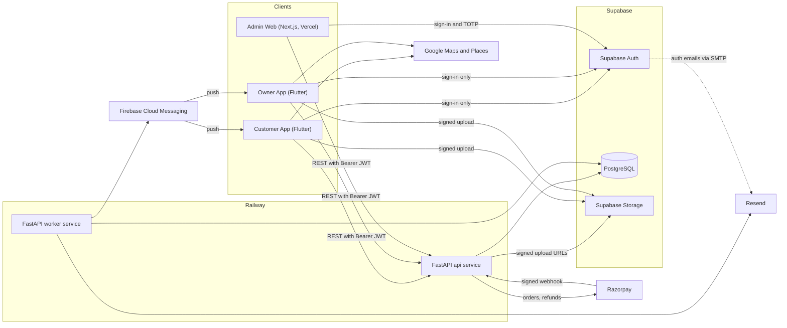
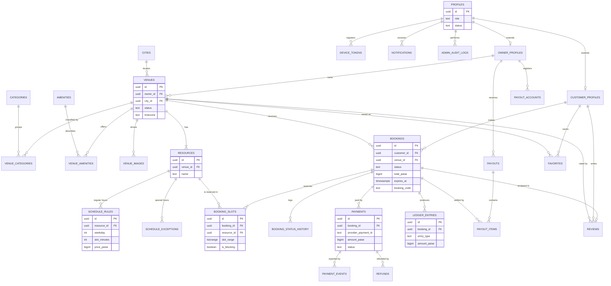
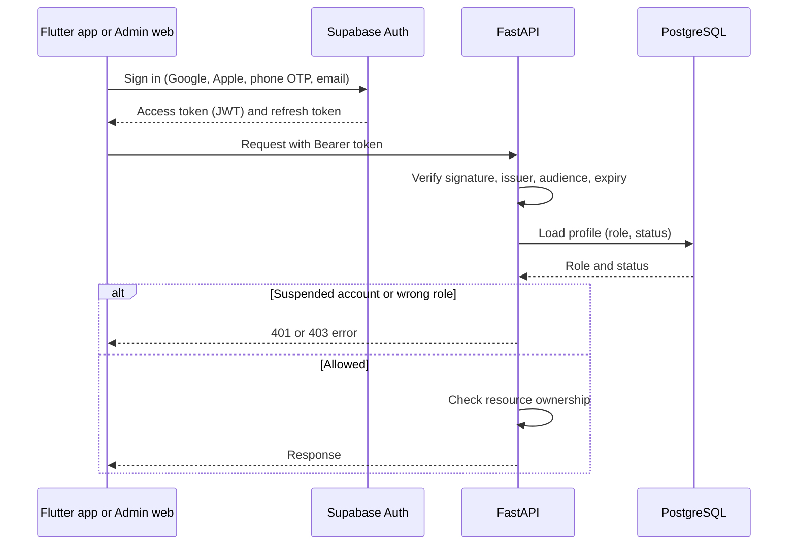
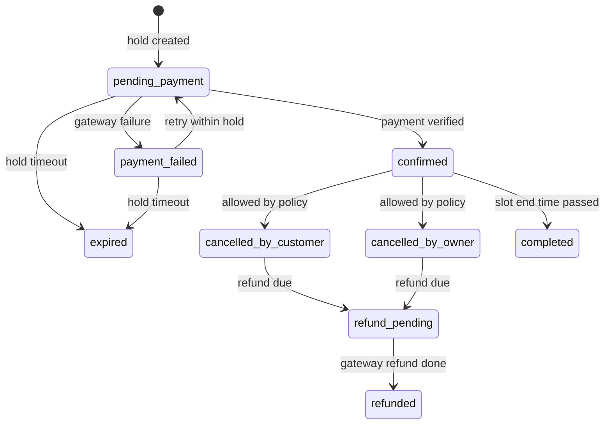
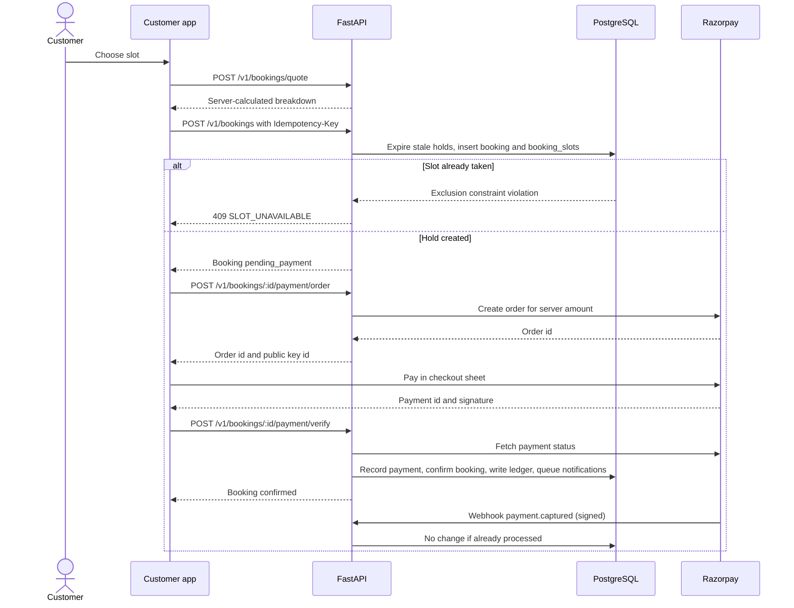
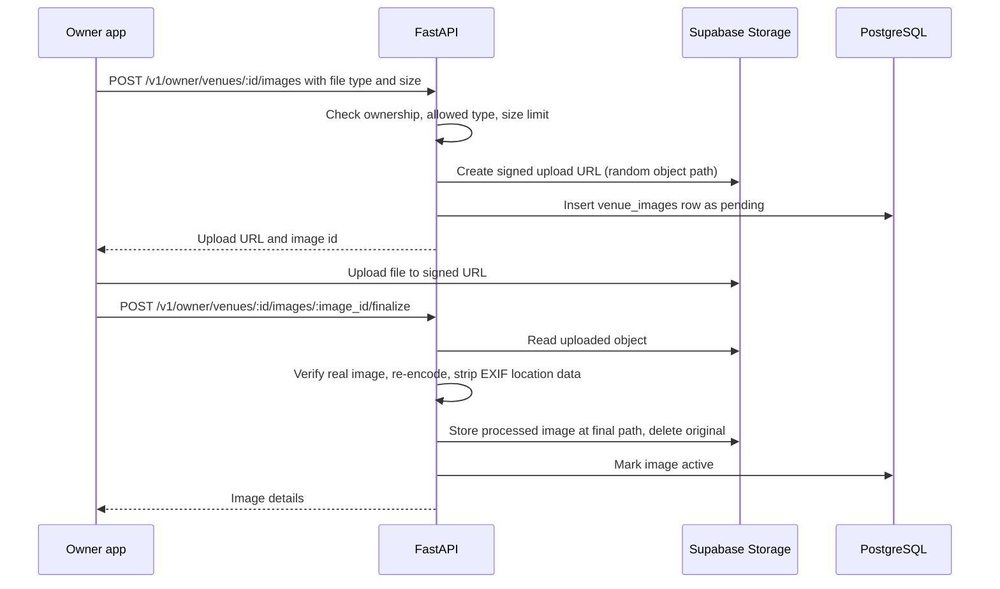
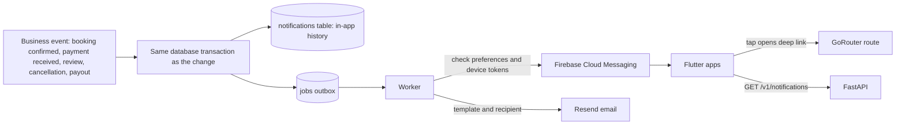

# ZURUV — SYSTEM ARCHITECTURE (Final, approved stack)

**Version:** 2.1 (approved stack; adds Mermaid diagrams, initial ER diagram, API communication, storage and notification architecture, and the API endpoint catalogue)
**Status:** Architecture finalised for the approved stack. No application code has been written. Work is organised in the fixed 10-stage roadmap (`IMPLEMENTATION_ROADMAP.md`); every "Step n" reference in this document refers to it.

**How to read this document**
- Decisions tagged **[Approved]** come from the client's stack approval.
- Decisions tagged **[Design]** are mine, made inside the approved stack, and need your review.
- Items tagged **[Pending Qn / Nn]** depend on an open business question in `OPEN_QUESTIONS.md`.
- Items tagged **[Verify]** are claims about third-party service behaviour that I have not been able to check against current documentation here. They are scheduled as Stage 2 verification spikes in `IMPLEMENTATION_ROADMAP.md`. Versions are deliberately not pinned in this document; they are pinned in Stage 2 after checking current stable releases.

**Source status:** the quotation PDF, the walkthrough video and any existing repository are still unavailable to me. This architecture is derived from the brief and the two UI boards.

---

## 1. Architectural principles

1. **One backend, one database.** All business rules live in FastAPI and PostgreSQL. Flutter apps and the admin site are clients; they never decide availability, price, payment state or permissions.
2. **The database is the last line of defence.** Double booking, duplicate payment processing and illegal states are prevented by constraints and transactions, not only by application code.
3. **Money is data, not code.** Fees, tax, commission, cancellation and hold rules are versioned configuration. Nothing from the illustrative UI numbers is hardcoded.
4. **Modular monolith.** One API codebase, one deployable image, two process roles (web, worker). No microservices, no message broker, no extra datastores.
5. **Provider boundaries.** Razorpay, FCM, Resend, Google Maps and Supabase Storage each sit behind a small adapter so a changed business decision (for example the payment provider) does not ripple through the code.
6. **Everything observable.** Every request, booking, payment and webhook is traceable by an ID.

---

## 2. Technology stack

### 2.1 Approved stack **[Approved]**

| Area | Technology |
|---|---|
| Mobile (Customer and Owner) | Flutter + Dart, Riverpod, GoRouter, Dio, Supabase Flutter (auth) |
| Backend | Python, FastAPI, SQLAlchemy 2.x, Pydantic v2, Alembic, Pytest |
| Data and infra | Supabase PostgreSQL, Supabase Auth, Supabase Storage |
| Admin web | Next.js, TypeScript, Tailwind CSS, shadcn/ui, Recharts |
| Integrations | Razorpay (pending launch-country and payment-requirement confirmation), Google Maps and Places, Firebase Cloud Messaging, Resend |
| Deployment | Railway (FastAPI), Vercel (Admin), Supabase Cloud, Google Play and Apple App Store |

### 2.2 Supporting tools chosen inside the approved stack **[Design]**

Kept to the minimum required to make the approved stack production-ready. Each one is a library or dev tool, not a new runtime service.

| Tool | Used for | Why it is needed |
|---|---|---|
| `uv` | Python dependency and environment management | Lockfile, reproducible builds in CI and Railway |
| Ruff, mypy | Python lint, format, type checking | Maintainability, catches errors before runtime |
| `pydantic-settings` | Typed environment configuration | Part of the Pydantic ecosystem; fails fast on missing config |
| asyncpg (SQLAlchemy async engine) | Database driver | Async I/O for FastAPI **[Verify]** pooler compatibility (see §5.2) |
| PyJWT | Verifying Supabase-issued JWTs | Signature, issuer, audience, expiry checks |
| `razorpay` official Python SDK | Orders, payment fetch, refunds, signature utilities | Avoids hand-rolling signature code |
| `firebase-admin` | FCM sending | Official server SDK |
| `resend` (or plain `httpx`) | Transactional email | Approved provider |
| `httpx` | Outbound HTTP and test client | Async client, also used by pytest |
| Pillow | Server-side image validation and re-encoding | Strips EXIF location data, rejects non-images |
| `structlog` (or stdlib JSON logging) | Structured logs | Railway collects stdout |
| Dart pub workspaces (+ optional Melos for scripts) | Flutter monorepo packages | Native workspace support; Melos only for task running |
| `freezed`, `json_serializable`, `riverpod_generator`, `build_runner` | Immutable models, JSON, providers | Standard Flutter code generation for the approved Riverpod/Dio stack |
| `flutter_secure_storage` | Session persistence | Tokens in Keychain/Keystore |
| `razorpay_flutter`, `google_maps_flutter`, `firebase_messaging` (+ `firebase_core`), `flutter_local_notifications` | Payment sheet, maps, push | Client SDKs for approved integrations |
| `react-hook-form`, `zod`, TanStack Table (via shadcn data table), `@supabase/ssr`, `openapi-typescript` | Admin forms, tables, auth, typed API | Dependencies of shadcn/ui or direct needs of the admin app |
| GitHub Actions, gitleaks | CI and secret scanning | Required by "no secrets in Git" |

### 2.3 Deliberately **not** included
Redis, Celery or any message broker · GraphQL · Kubernetes · microservices · a separate search engine · a data warehouse · Docker orchestration beyond local Compose · a second backend framework. If a real load or product need appears later, each can be proposed with evidence. Optional items that would need your approval are listed in §14.

---

## 3. System overview



**Key boundary:** the mobile and admin clients talk to Supabase **only for authentication**. All data reads and writes go through FastAPI. Supabase's auto-generated data API is not used for application data (see §8.3).

---

## 4. Monorepo structure **[Design]**

```
zuruv/
├── README.md
├── pubspec.yaml                 # Dart pub workspace root (apps + packages)
├── melos.yaml                   # optional: scripts only (analyze, test, build_runner)
├── Makefile                     # developer entry points: make api, make db-up, make test
├── docker-compose.yml           # local Postgres (+PostGIS) for development and tests
├── .github/
│   └── workflows/               # api.yml, customer-app.yml, owner-app.yml,
│                                # admin-web.yml, secrets-scan.yml, db-migrations.yml
├── apps/
│   ├── customer_app/            # Flutter (Customer)
│   │   ├── lib/
│   │   │   ├── main_dev.dart · main_staging.dart · main_prod.dart
│   │   │   ├── app/             # App widget, router, theme wiring, bootstrap
│   │   │   └── features/        # onboarding, auth, home, venues, availability,
│   │   │                        # booking, payment, my_bookings, favorites,
│   │   │                        # profile, notifications, reviews
│   │   ├── android/ · ios/ · test/ · integration_test/
│   │   └── env/                 # dev.json · staging.json · prod.json (non-secret)
│   ├── owner_app/               # Flutter (Owner) — same internal layout
│   │   └── lib/features/        # onboarding, auth, dashboard, venues, venue_editor,
│   │                            # schedule, bookings, earnings, analytics, reviews,
│   │                            # notifications, profile
│   └── admin_web/               # Next.js + TypeScript
│       ├── src/
│       │   ├── app/             # routes: (auth)/login, (dashboard)/…
│       │   ├── components/ui/   # shadcn/ui components
│       │   ├── features/        # dashboard, vendors, customers, bookings, analytics
│       │   └── lib/             # api client (typed), supabase, formatting
│       ├── tailwind.config.ts · components.json · package.json
│       └── .env.example
├── packages/                    # shared Flutter packages
│   ├── zuruv_design/            # design tokens, theme, shared widgets (buttons,
│   │                            # cards, slot grid, status chips, empty/error states)
│   ├── zuruv_core/              # Dio client + interceptors, error model, config,
│   │                            # logging, secure session storage, router helpers
│   ├── zuruv_api/               # DTOs (freezed) and repositories for API modules
│   └── zuruv_auth/              # Supabase session wrapper, sign-in flows, role gate
├── services/
│   └── api/                     # FastAPI backend (single deployable image)
│       ├── pyproject.toml · uv.lock · Dockerfile
│       ├── src/zuruv_api/
│       │   ├── main.py          # create_app(): middleware, routers, handlers
│       │   ├── worker.py        # worker entry point (job loop)
│       │   ├── core/            # config, security (JWT), errors, logging,
│       │   │                    # request-id, rate limit, idempotency
│       │   ├── db/              # engine/session, base model, models/, types
│       │   ├── modules/         # one folder per domain module (see §6.1)
│       │   │   └── <module>/    # router.py · schemas.py · service.py · repository.py
│       │   ├── domain/          # pure logic with no I/O: slot_engine.py,
│       │   │                    # pricing.py, booking_state.py, policies.py
│       │   ├── integrations/    # razorpay/, fcm/, resend/, maps/, storage/
│       │   └── jobs/            # handlers: expire_holds, send_push, send_email,
│       │                        # reconcile_payments, payouts, stats_refresh
│       └── tests/               # unit/ · integration/ · concurrency/ · contract/
├── database/
│   ├── alembic.ini
│   ├── migrations/              # env.py (imports models from services/api) + versions/
│   ├── seed/                    # reference data: cities, categories, amenities
│   └── sql/                     # extensions, test-only auth schema stub, RLS baseline
├── infra/
│   ├── railway/                 # service definitions, start/pre-deploy commands
│   ├── supabase/                # documented project settings: auth providers,
│   │                            # buckets and policies, exposed schemas, SMTP
│   └── scripts/                 # create_admin.py, rotate-keys checklist, backups
└── docs/
    ├── PROJECT_CONTEXT.md · REQUIREMENTS_MATRIX.md · OPEN_QUESTIONS.md
    ├── SYSTEM_ARCHITECTURE.md · IMPLEMENTATION_ROADMAP.md
    ├── adr/                     # one file per accepted decision after Stage 2
    ├── api/openapi.json         # committed snapshot, CI detects breaking changes
    ├── design/                  # board images, extracted tokens, missing-screen designs
    └── reference/               # quotation.pdf, app-walkthrough.mp4, UI boards
```

**Structural notes**
- **Alembic location:** migrations live in `database/` as requested, but the SQLAlchemy models stay in `services/api` (they are the application's own code). `database/migrations/env.py` imports the models from the API package, which is installed in editable mode through the uv workspace. One schema definition, one migration history.
- **Dart workspaces:** both Flutter apps and all four packages are members of one pub workspace so they resolve one dependency graph.
- **Why four shared Flutter packages and no more:** design, networking/config, API contracts and authentication are the four things both apps genuinely share. Anything used by one app stays in that app.
- **Path-filtered CI:** a change in `apps/owner_app` does not rebuild the customer app; a change in `packages/*` triggers both apps.

---

## 5. Database and infrastructure architecture

### 5.1 Responsibilities of Supabase
| Service | Role in ZURUV | Not used for |
|---|---|---|
| PostgreSQL | System of record, booking concurrency, ledger | Direct access from clients |
| Auth | Identity (Google, Apple, phone OTP, email), JWT issuance, MFA for admins, password reset | Business roles or permissions (kept in our tables) |
| Storage | Venue images and avatars | Unvalidated direct client uploads |
| Realtime, Edge Functions, PostgREST data API | **Not used** | — |

### 5.2 Connection strategy **[Design] [Verify]**
- FastAPI connects with SQLAlchemy 2.x async using a server-side database role over the **Supabase connection pooler**. Railway's outbound network is IPv4 and Supabase's direct database host may be IPv6-only, so the pooler is the planned route.
- If the pooler is used in **transaction mode**, prepared statements must be disabled in the driver and SQLAlchemy configured accordingly; in **session mode** this is not needed but connection counts are higher. Stage 2 spike decides, by running the booking concurrency test through the chosen pooler.
- Pool size is set per service instance so total connections stay under the plan's limit with the API and worker both running.
- Alembic uses a direct or session-mode connection (DDL and advisory locks must not go through transaction pooling).
- Postgres extensions required: `btree_gist` (exclusion constraint), `postgis` (distance queries), `pgcrypto` or built-in UUID generation.

### 5.3 Environments
Three separate Supabase projects (development, staging, production), each with its own Auth settings, buckets and keys. Matching Railway environments and Vercel environments. Razorpay test keys in dev and staging, live keys only in production. Production uses a paid Supabase plan with backups enabled **[Verify plan limits]**; the free plan is not acceptable for production data.

### 5.4 Local and test databases
Docker Compose runs PostgreSQL with the required extensions. Because migrations reference Supabase's `auth.users`, `database/sql/` contains a **test-only stub of the `auth` schema** so the same migrations run locally, in CI and against Supabase. A scheduled CI job also runs the migration set against the staging Supabase project to catch drift.

---

## 6. Backend architecture (FastAPI)

### 6.1 Modules
Each module owns its tables and exposes services; other modules call services, never each other's repositories.

| Module | Responsibility |
|---|---|
| `auth` / `users` | `GET /me`, role registration, account status, device tokens |
| `customers`, `owners` | Profiles; owner business, KYC fields, payout account |
| `catalog` | Cities, categories, amenities (reference data) |
| `venues` | Venue CRUD, status lifecycle, resources (courts), listing queries |
| `media` | Signed upload creation, finalisation and validation, deletion |
| `schedules` | Regular hours, special hours, price rules |
| `availability` | Slot generation endpoint (uses `domain/slot_engine`) |
| `pricing` | Quote calculation (uses `domain/pricing`), fee and tax configuration |
| `bookings` | Hold, confirm, cancel, expire, status history |
| `payments` | Razorpay orders, verification, webhook intake, reconciliation |
| `refunds` | Policy evaluation and gateway refunds |
| `ledger` | Immutable money entries |
| `payouts` | Owner earnings, payout records (provider **[Pending Q10]**) |
| `reviews`, `favorites` | Ratings, replies, saved venues |
| `notifications` | In-app records, push and email dispatch via jobs |
| `analytics` | Owner and admin aggregate queries |
| `admin` | Vendor, customer, booking management; master data; audit log |

### 6.2 Layering and rules
- **Router** → validates input (Pydantic v2), resolves the current user, calls a service. No business logic.
- **Service** → business rules, authorisation against the resource (owner owns venue, customer owns booking), transaction boundaries.
- **Repository** → SQLAlchemy queries only.
- **`domain/`** → pure functions (slot generation, price calculation, state machine, cancellation policy evaluation). No database, network or clock access beyond injected arguments; this is where unit tests concentrate.
- Business rules are never duplicated in Flutter or Next.js.

### 6.3 API conventions
REST, JSON, versioned under `/v1`. OpenAPI generated by FastAPI and snapshotted into `docs/api/openapi.json`. Cursor pagination. Error body: `{ "code", "message", "details", "request_id" }` with stable machine codes (for example `SLOT_UNAVAILABLE`, `HOLD_EXPIRED`, `PAYMENT_NOT_VERIFIED`). `Idempotency-Key` header required on booking creation and payment-order creation. All timestamps UTC in the API; venue-local time derived from the venue's IANA time zone.

### 6.4 Background work without a broker **[Design]**
- A `jobs` table acts as a **transactional outbox**: business transactions insert job rows (send push, send email, retry webhook, refund, payout) in the same transaction as the change. This guarantees no lost notifications and no notification for a rolled-back change.
- The **worker** service polls with `SELECT … FOR UPDATE SKIP LOCKED`, runs handlers, records attempts and backoff, and marks dead jobs for alerting. It can run multiple replicas safely.
- Scheduled maintenance (hold expiry sweep, payment reconciliation, stats refresh) is a loop in the worker guarded by a PostgreSQL advisory lock so only one instance runs each schedule.
- If throughput ever outgrows this, the outbox can be fronted by a queue later; no decision is made now.

### 6.5 Rate limiting and caching **[Design]**
No Redis. Rate limiting is best-effort in-process (per instance) for general endpoints; sensitive flows (OTP, login, booking creation, webhook intake) lean on Supabase Auth's own limits, idempotency keys and database uniqueness. Read-mostly data (categories, amenities, cities) can be cached in-process with short TTLs. If shared limits or caching become necessary, that is a new approval request.

### 6.6 Logging, errors, health
- Structured JSON logs with `request_id`, user id, route, latency; secrets, tokens and bank details are redacted.
- Global exception handlers translate domain errors to the error format; unexpected errors return a generic message and log the stack trace.
- `GET /healthz` (process alive) and `GET /readyz` (database reachable) for Railway health checks.

### 6.7 Testing (Pytest)
Unit tests for `domain/`; integration tests against real PostgreSQL (constraints, transactions, RBAC matrix); **concurrency tests** (many simultaneous booking attempts for one slot); webhook tests (valid, forged, replayed, out-of-order); contract tests (OpenAPI snapshot); analytics tests that recompute each KPI independently from raw rows.

---

## 7. Data architecture (candidate schema, finalised in Stage 3)

Conventions: UUID primary keys; money as integer paise (`BIGINT`) plus currency code; `created_at` / `updated_at`; foreign keys and check constraints throughout; enums as PostgreSQL types or checked text; every schema change through Alembic.

| Group | Tables |
|---|---|
| Identity | `profiles` (id = Supabase `auth.users.id`, role, status, display name, phone, email), `customer_profiles`, `owner_profiles`, `device_tokens`, `admin_audit_logs` |
| Catalog | `cities`, `categories`, `amenities` |
| Venues | `venues` (owner_id, city_id, geography point, place_id, tz, status, rating aggregates), `venue_images`, `venue_categories`, `venue_amenities`, `resources` (courts; one default resource per venue unless Q17 says otherwise) |
| Scheduling | `schedule_rules` (resource/venue, weekday, open, close, slot_minutes, price_paise), `schedule_exceptions` (date range, closed / modified hours / modified price) |
| Booking | `bookings` (customer, venue, status, price snapshot, policy snapshot, `expires_at`, booking_code, idempotency key), `booking_slots` (booking, resource, `tstzrange`, `is_blocking`), `booking_status_history` |
| Money | `payments`, `payment_events` (unique provider event id), `refunds`, `fee_configs` (versioned), `cancellation_policies` (versioned), `ledger_entries`, `payout_accounts` (encrypted), `payouts`, `payout_items` |
| Optional | `coupons`, `coupon_redemptions` **[Pending N7]** |
| Engagement | `reviews` (with owner reply columns or `review_responses`), `favorites`, `notifications`, `notification_preferences` |
| System | `jobs` (outbox), `venue_daily_stats` (only if Stage 7 profiling shows need) |

`profiles.id` references `auth.users(id)`. The `profiles` table is the source of truth for **role and account status**.

### 7.1 Initial entity relationship diagram (proposal)

This is a **proposal**. Relationships marked in the notes below are not final until the booking and venue model questions (Q1, Q2, Q17, N2, N23) are answered. Auth users live in Supabase's `auth.users`; `PROFILES` shares its id.



**Relationships that are not final**

| Relationship | Open decision |
|---|---|
| `VENUES` to `RESOURCES` (one-to-many, minimum one) | Whether courts are bookable units, or the venue itself is (Q1, Q2, Q17). If a venue is always booked whole, `RESOURCES` collapses to one hidden default row. |
| `BOOKINGS` to `BOOKING_SLOTS` (one-to-many) | One booking may reserve several courts and/or consecutive slots (Owner board shows "2 Courts"). Depends on Q2 and N2. |
| Whole bookings vs capacity | Gym and yoga may need capacity per slot instead of exclusive resources (N23); the exclusion constraint would not apply. |
| `BOOKINGS` to `REVIEWS` (zero or one) | Who may review and when (Q15). |
| `PAYOUTS` and `PAYOUT_ITEMS` | Payout mechanism and grouping (Q10). |
| `LEDGER_ENTRIES` | Entry types depend on fee, tax and commission rules (Q7, Q8). |
| Fee, tax and cancellation configuration tables | Structure depends on Q7, Q8 and Q9; they are linked to bookings only through a stored snapshot. |
| Coupons | Not drawn; only if approved (N7). |
| Admin records | Only `ADMIN_AUDIT_LOGS` is drawn; admin role tiers depend on Q18 and N12. |


---

## 8. Authentication and authorisation

### 8.1 Flow **[Design]**
1. Flutter and the admin site sign in through Supabase Auth (Google and Apple via native identity tokens, phone OTP, email). Admin uses email + password + TOTP only.
2. The client sends `Authorization: Bearer <access token>` to FastAPI.
3. FastAPI verifies the JWT signature against Supabase's signing keys, plus issuer, audience and expiry **[Verify key type: JWKS vs shared secret for the project]**.
4. FastAPI loads `profiles` (one primary-key lookup) to obtain the **authoritative role and status**. A suspended account is rejected immediately even if its token is still valid.
5. Services apply resource-level checks.

**Never trusted for authorisation:** `user_metadata` (user-editable). Role comes only from `profiles`.



### 8.2 Role assignment
- After first sign-in, the Customer app calls `POST /v1/auth/register/customer`; the Owner app calls `POST /v1/auth/register/owner`. Each creates `profiles` plus the matching profile row. If the identity already has a different role, the API returns a conflict. **[Pending N10: whether one person may be both customer and owner. The schema above assumes one role per account.]**
- Admins are **never** created through public registration. A script in `infra/scripts` (using the service-role key, run by an operator) creates an admin identity and profile.
- Admin endpoints require role `admin` **and** an MFA-verified session (authenticator assurance level 2 **[Verify claim name]**).

### 8.3 Database access policy **[Design]**
- FastAPI uses a privileged server role, so Row-Level Security is bypassed for it by design. Therefore:
  - RLS is **enabled on every application table** with **no policies granted to `anon` or `authenticated`**, so even a leaked anon key reads nothing.
  - The application schema is **not exposed** through Supabase's auto-generated data API.
  - Service-role and database credentials exist only in Railway secrets, never in a client or in Git.
- Storage buckets: `venue-images` public-read (listing photos), writes only through backend-issued signed upload URLs; `private-docs` (owner verification files, if N11 requires them) fully private with signed short-lived access.

### 8.4 Permission matrix
| Capability | Customer | Owner | Admin |
|---|---|---|---|
| Browse published venues | ✔ | ✔ | ✔ |
| Create / update / publish venue | ✖ | own venues | ✖ (not by default; Q4, Q18) |
| Manage schedules and prices | ✖ | own venues | ✖ |
| Create booking and pay | ✔ | ✖ | ✖ |
| View booking | own | bookings on own venues | all (read) |
| Cancel booking | own, per policy | per policy **[C10, N22]** | per Q18 |
| View earnings and payouts | ✖ | own | platform-wide |
| Manage accounts | own profile | own profile | per Q18 |
| Manage categories, amenities, cities | ✖ | ✖ | per N13 |

---

## 9. Booking engine **[Design]**

### 9.1 Availability (slot generation)
Slots are **generated on demand**, not stored. For a resource and date range: load `schedule_rules`, apply `schedule_exceptions` (an exception **replaces** the regular rule for its dates **[Pending Q16 precedence rule]**), cut into slots of the configured duration in the venue's time zone with `zoneinfo`, convert to UTC ranges, remove ranges overlapping **blocking** `booking_slots` (including unexpired holds), and apply booking-window rules **[Pending N6]**. One function in `domain/slot_engine.py` serves the slot screen, the "Today" filter and the owner analytics, so they cannot disagree.

### 9.2 Preventing double booking (the core guarantee)
```
booking_slots(
  id, booking_id, resource_id, slot_range tstzrange, is_blocking boolean, ...
  EXCLUDE USING gist (resource_id WITH =, slot_range WITH &&) WHERE (is_blocking)
)
```
- Each reserved resource-and-time is a row in `booking_slots`. The constraint makes it **impossible** for two blocking rows to overlap on the same resource, regardless of application bugs or concurrent requests.
- This one structure covers the open scope questions: a single court, several courts in one booking (the Owner board shows "2 Courts"), or a whole venue (one row per resource) **[Pending Q1, Q2, Q17, N2]**.
- `is_blocking` is maintained by the booking state machine in the same transaction as each status change (it is `true` for `pending_payment` and `confirmed`, `false` otherwise).
- **Limit of this approach:** it models exclusive resources. Capacity-style sessions (several people in one yoga or gym slot) need a counting mechanism instead **[Pending N23]**; this is not built until confirmed.

### 9.3 Create-hold transaction
In one database transaction:
1. Check the `Idempotency-Key`; return the existing booking on retry.
2. **Lazily expire** any holds on the same resource and overlapping range whose `expires_at` has passed (set `is_blocking = false`, status `expired`). This makes correctness independent of the sweeper job, because the exclusion constraint cannot reference the current time.
3. Validate the requested slot against the schedule using the slot engine.
4. Compute the price server-side from versioned configuration and store the snapshot.
5. Insert `bookings` (`pending_payment`, `expires_at = now + configured hold`) and `booking_slots`.
6. A constraint violation is translated into `409 SLOT_UNAVAILABLE`.

The hold duration is configuration **[Pending N4]**; no default is invented. A periodic sweeper additionally expires old holds for hygiene.

### 9.4 Status model (proposed — confirm Q11)
| From | To | Trigger | `is_blocking` after |
|---|---|---|---|
| (new) | `pending_payment` | Hold created | true |
| `pending_payment` | `confirmed` | Payment verified as captured | true |
| `pending_payment` | `expired` | Hold timeout | false |
| `pending_payment` | `payment_failed` | Gateway failure; may retry within the hold | true until hold expiry |
| `confirmed` | `cancelled_by_customer` | Allowed by policy **[Q9]** | false |
| `confirmed` | `cancelled_by_owner` | Allowed by policy **[Q9, N22]** | false |
| `confirmed` | `completed` | Slot end time passed | false |
| any cancelled | `refund_pending` → `refunded` | Per refund policy **[Q9]** | false |

All transitions go through one function in `domain/booking_state.py`; each writes `booking_status_history`. Customer, owner and admin UIs read the same status and map it to display labels.


The diagram is the proposed model; it becomes final only when Q11 is answered.


### 9.5 Cancellation, refunds, special hours
Cancellation policy is versioned data, snapshotted on each booking at purchase **[Pending Q9]**. Special hours that would affect confirmed bookings are detected before saving; by default the change is blocked until the rule in Q16 is confirmed.

---

## 10. Payments (Razorpay) **[Pending launch country and payment requirements]**

Razorpay sits behind a `PaymentGateway` interface so a different provider remains possible if the country or marketplace requirements change.

### 10.1 Payment flow
1. App requests a **quote**; the server returns the breakdown.
2. App creates a hold; server creates a Razorpay **order** for the server-calculated amount in paise, with the booking code as receipt.
3. App opens the Razorpay checkout through `razorpay_flutter`.
4. On client success, the app calls `POST /v1/bookings/{id}/payment/verify` with the order id, payment id and signature. The server verifies the signature **and** fetches the payment from Razorpay to confirm its status. The client result alone never confirms a booking.
5. **Webhook** `POST /v1/webhooks/razorpay`: the raw request body is verified against the webhook signature using the webhook secret **[Verify header names and event list]**. The event is stored in `payment_events` with a **unique provider event id**; replays are no-ops.
6. Both the verify endpoint and the webhook call the same idempotent function that, in one transaction, records the captured payment, moves the booking to `confirmed`, writes ledger entries and inserts notification jobs.
7. The app shows "Booking Confirmed" only when the server reports `confirmed`; if the webhook lags, the app shows a "confirming payment" state and polls the booking.



### 10.2 Edge cases
- **Late payment after hold expiry:** re-check the slot inside the transaction; confirm if still free, otherwise queue an automatic refund **[Pending N5]**.
- **Duplicate payment attempts:** one `payments` row per order; unique constraints on provider payment id; repeated client taps return the same order via the idempotency key.
- **Amount tampering:** the amount is never taken from the client.
- **Capture mode:** auto-capture is recommended so authorised payments do not lapse **[Verify and confirm with Razorpay account settings]**.
- **Reconciliation:** a worker job compares `payments` with Razorpay records daily and flags mismatches for the admin.

### 10.3 Refunds and payouts
Refunds go through the same adapter, initiated by policy evaluation, recorded in `refunds` and `ledger_entries`, processed idempotently. **Owner payouts depend on an undecided mechanism** (Razorpay marketplace/transfer products versus another payout method) and on owner KYC requirements **[Pending Q10, Q8, N11]**. The `payouts` module is designed against a `PayoutProvider` interface and is not implemented until Q10 is answered.

### 10.4 Ledger
`ledger_entries` are append-only and keep four concepts separate: customer payment, platform revenue (fee and commission), tax, owner earning, and payout. Reports and dashboards read from the ledger; they never recompute money from bookings alone.

---

## 11. Mobile architecture (Flutter, Customer and Owner)

### 11.1 Layout and layering
Feature-first folders; inside each feature: `presentation` (widgets, Riverpod controllers), `application` (use-case logic), `data` (repositories using `zuruv_api`), `domain` (entities). UI never calls Dio directly.

### 11.2 Riverpod
Providers are generated with `riverpod_generator`. Server state (venues, bookings, availability) is exposed as async providers with explicit invalidation on mutation; ephemeral UI state stays in widgets or small notifiers. Booking flow is a state machine notifier with server-authoritative checkpoints (quote → hold → pay → confirmed).

### 11.3 GoRouter
Typed routes; auth redirect guard driven by Supabase session state **and** the role returned by `GET /v1/me` (an Owner account signing in to the Customer app is signed out with a clear message, and vice versa). `StatefulShellRoute` for persistent bottom navigation (Customer: Home, Bookings, Favorites, Profile. Owner: Dashboard, Venues, Bookings, Payments, More). Deep links for booking confirmation and notification taps.

### 11.4 Dio
One configured client in `zuruv_core` with interceptors for: attaching the current access token and refreshing it, `request-id`, `Idempotency-Key` on designated calls, retry with backoff for safe GET requests only, error mapping to a typed `AppFailure` (network, auth, validation, conflict, server), and redacted logging in debug builds.

### 11.5 Auth with Supabase Flutter
Supabase Flutter is used for sign-in, session refresh and sign-out only. Session persistence uses `flutter_secure_storage`. Google and Apple use native identity tokens exchanged with Supabase. Phone OTP requires an SMS provider configured in Supabase **[Not in the approved stack — see §13, N24]**.

### 11.6 Cross-cutting
Flavors dev / staging / prod through separate entry points and non-secret per-app `.env` files loaded with `flutter_dotenv`; **no secrets in the app** (only public identifiers such as the Supabase URL, anon key and restricted Maps key). Every screen has loading, empty, error and success states. API contracts are consumed through `zuruv_api` DTOs; the committed `openapi.json` snapshot is the contract reference **[Pending: DTO generation vs hand-written, decided in Stage 2]**. Push: `firebase_messaging` registers the device token with the backend; foreground messages shown with `flutter_local_notifications`.

### 11.7 Maps
`google_maps_flutter` for map display and owner location picking; Places autocomplete for address entry. Keys are restricted by platform (Android package and signing certificate, iOS bundle ID) and by API. The backend stores latitude, longitude and place id and validates ranges; "Near me" sends coordinates to the API, which uses PostGIS distance queries with a GiST index.

---

## 12. Admin web architecture (Next.js)

- Next.js App Router, TypeScript, Tailwind, shadcn/ui, Recharts, using the same colour and typography tokens as the mobile design (exported from `docs/design`).
- Auth with `@supabase/ssr` (cookie sessions); email + password + mandatory TOTP. Pages are server-rendered; data is fetched **server-side** with the user's access token so API calls and tokens are not exposed to the browser where avoidable.
- Types from the committed OpenAPI snapshot via `openapi-typescript`.
- Tables use the shadcn data-table pattern with server-side pagination, filters and booking-ID search. Charts are fed only by `/v1/admin/analytics/*` endpoints.
- Admin write actions limited to what Q18 and N13 confirm; every write is audit-logged by the API.
- CORS on the API allows only the admin origins (production domain and Vercel previews for staging); mobile apps do not need CORS.

---

## 13. Integration dependencies

| Integration | Purpose | Credentials / setup needed | Lead time or risk | Blocked by |
|---|---|---|---|---|
| **Supabase** (3 projects) | DB, Auth, Storage | Projects, region, paid plan for production, backups | Low | N1 (region), N18 |
| **Supabase Auth: Google** | Social login | Google Cloud OAuth clients (Android, iOS, web) | Low | Developer accounts |
| **Supabase Auth: Apple** | Social login | Apple Developer Program, Services ID, key | Medium (account approval) | N19 |
| **Supabase Auth: Phone OTP** | Boards show "Continue with Phone" | **An SMS provider is required by Supabase and is not in the approved stack.** India sender/template registration requirements **[Verify]** | **High (registration lead time)** | **N24, N10** |
| **Resend** | Booking, payment and account emails; can also be Supabase's SMTP for auth emails | Domain with SPF/DKIM verified, API key | Low–medium | Domain ownership, N20 (templates) |
| **Razorpay** | Payments, refunds, webhooks | Merchant account activation and KYC, test and live keys, webhook secret | **High (business verification)** | Launch country, Q5, Q6 |
| **Razorpay payouts to owners** | Owner payouts | Marketplace or payout product activation, owner onboarding data | **High; mechanism undecided** | **Q8, Q10, N11** |
| **Firebase (FCM)** | Push | Firebase project, Android and iOS apps, **Apple APNs key** for iOS, service account for the backend | Medium | N19 |
| **Google Maps Platform** | Map SDK, Places autocomplete, geocoding | Billing account, restricted keys (Android, iOS, server) | Low; ongoing cost | Q12 |
| **Railway** | API and worker hosting | Project, environments, secrets, pre-deploy migration command **[Verify]**, region (Singapore likely nearest to India **[Verify]**) | Low | N18 |
| **Vercel** | Admin hosting | Project, domains, environment variables | Low | — |
| **Google Play / App Store** | Distribution | Developer accounts, app IDs, signing, privacy forms, store listings | Medium (review times) | N19, N20 |
| **GitHub** | Repository and CI | Repository, branch protection, Actions secrets | Low | — |

**Unresolved business rules that gate the architecture** (full list in `OPEN_QUESTIONS.md`):
Q1/Q2/Q17/N2/N23 (what is bookable and slot model) · Q7/Q8 (fees, tax, commission) · Q9/N22 (cancellation and refunds) · Q10/N11 (payouts and owner KYC) · Q11 (status table) · Q16 (special hours vs bookings) · N4/N5 (hold duration, late payment) · N10 (identity linking, roles) · launch country for Razorpay.

---

## 14. Items outside the approved stack that need your decision

These are not added. Each is something a production system will otherwise lack:

| Item | Why it matters | Minimal option |
|---|---|---|
| SMS/OTP provider for phone sign-in | Supabase phone login does not work without one | Pick a provider supported by Supabase and compatible with Indian requirements, or drop phone login from launch scope |
| Error tracking (backend and apps) | Production bugs and crashes are otherwise invisible except in logs | Firebase Crashlytics for the apps (same Firebase project); Sentry or Railway logs only for the backend |
| Mobile release automation | Manual store releases are error-prone | GitHub Actions with `flutter build` first; fastlane only if needed |
| WhatsApp or SMS notifications | Mentioned in Q14, not approved | Defer; push + email only |
| Shared rate limiting/cache (Redis) | Only if load testing shows per-instance limits are insufficient | Not planned |

---

## 15. Security architecture summary

- TLS everywhere; JWT verification on every request; role and status from the database on every request.
- Resource-level authorisation in services; deny by default; RBAC tests for every endpoint.
- Secrets only in Railway, Vercel, GitHub Actions and Supabase secret stores; `.env.example` files document every variable; gitleaks in CI; separate keys per environment.
- Server-side validation (Pydantic v2) and output encoding; parameterised queries through SQLAlchemy only.
- Images: signed upload, size and type limits, server-side verification and re-encoding with Pillow, random object names.
- Payments: server-calculated amounts, signature checks, unique event ids, reconciliation. Card data never reaches ZURUV servers.
- Sensitive data: bank details encrypted at the application level, masked in API responses; customer contact details shown to owners only as permitted **[Pending N9]**.
- Admin: MFA required, no public registration, audit log of every write.
- RLS deny-all on application tables, data API unexposed, least-privilege database roles.
- Compliance and data retention reviewed with counsel **[Pending N17]**.

## 16. Environment variables (documented, values never committed)

| Service | Variables (names only) |
|---|---|
| API | `ENV`, `DATABASE_URL`, `SUPABASE_URL`, `SUPABASE_JWT_ISSUER`, `SUPABASE_JWKS_URL` (or `SUPABASE_JWT_SECRET`), `SUPABASE_SERVICE_ROLE_KEY`, `RAZORPAY_KEY_ID`, `RAZORPAY_KEY_SECRET`, `RAZORPAY_WEBHOOK_SECRET`, `FCM_SERVICE_ACCOUNT_JSON`, `RESEND_API_KEY`, `EMAIL_FROM`, `GOOGLE_MAPS_SERVER_KEY`, `ALLOWED_ORIGINS`, `HOLD_MINUTES` (until configured in DB), `LOG_LEVEL` |
| Worker | Same as API plus `WORKER_CONCURRENCY` |
| Admin web | `NEXT_PUBLIC_SUPABASE_URL`, `NEXT_PUBLIC_SUPABASE_ANON_KEY`, `API_BASE_URL` |
| Flutter apps (non-secret, `env/*.json`) | `API_BASE_URL`, `SUPABASE_URL`, `SUPABASE_ANON_KEY`, `GOOGLE_MAPS_KEY` (restricted), `RAZORPAY_KEY_ID` (public key id only), `ENV` |

## 17. Deployment architecture

- **Railway:** two services from one Docker image — `api` (Uvicorn behind Gunicorn, health check `/readyz`) and `worker`. Alembic runs as a pre-deploy step **[Verify Railway feature]**; migrations follow expand-then-contract so a rolling deploy never breaks the running version. Each environment has its own variables.
- **Vercel:** Next.js admin with production and preview environments; previews point to the staging API.
- **Supabase Cloud:** one project per environment; backups enabled in production; Auth, SMTP (Resend) and storage settings documented in `infra/supabase`.
- **Mobile:** dev, staging and production flavors; internal testing tracks (Play) and TestFlight before any store release.
- **CI (GitHub Actions):** per-component workflows — API (Ruff, mypy, Pytest with Postgres service), Flutter (analyze, test, build_runner check), Admin (lint, typecheck, build), secrets scan, OpenAPI snapshot diff, migration check on a fresh database.
- **Operations:** health checks and uptime monitor, alert on dead jobs and webhook failures, backup restore drill before launch.

---

## 18. API communication

**Transport and style:** HTTPS, JSON, REST, versioned under `/v1`. OpenAPI is generated by FastAPI and snapshotted into `docs/api/openapi.json`; CI fails on unreviewed breaking changes.

| Concern | Convention |
|---|---|
| Authentication | `Authorization: Bearer <Supabase access token>` on every endpoint except the public ones marked in §21 |
| Idempotency | `Idempotency-Key` header required on booking creation and payment-order creation; the same key returns the original result |
| Tracing | Client may send `X-Request-ID`; the server always returns one and logs it |
| Pagination | `limit` and `cursor` query parameters; responses carry `next_cursor` |
| Filtering and sorting | Query parameters validated by Pydantic; unknown parameters rejected |
| Errors | `{ "code", "message", "details", "request_id" }` with HTTP status; stable machine codes such as `SLOT_UNAVAILABLE`, `HOLD_EXPIRED`, `PAYMENT_NOT_VERIFIED`, `FORBIDDEN`, `VALIDATION_ERROR` |
| Money | Integer minor units (paise) and a currency code; the currency and country are confirmed by N1 and N25 |
| Time | UTC ISO-8601 in the API; the venue's IANA time zone is returned with venue and slot data so clients display local time |
| Rate limiting | In-process per instance (§6.5); `429` with `Retry-After` |
| CORS | Allowed only for the admin web origins; mobile apps do not use CORS |
| Webhooks | Raw body signature verification, unique event id, replay-safe (§10) |
| Client communication | Flutter: one Dio client (`zuruv_core`) with auth, retry (safe GET only), error mapping. Admin: server-side fetch with the user's token |

**Auth flows (sign-in, OTP, refresh, password reset, MFA) are handled by Supabase Auth directly and are not FastAPI endpoints.**

## 19. Storage architecture

**Provider:** Supabase Storage. All writes are brokered by the backend; clients never receive a service key.

| Bucket | Content | Read access | Write access |
|---|---|---|---|
| `venue-images` | Listing photographs | Public read (listing photos are public) | Backend-issued signed upload URL only |
| `avatars` | Profile pictures (only if profile photos are in scope; not shown on the boards) | Public or signed read | Backend-issued signed upload URL only |
| `private-docs` | Owner verification documents, only if N11 requires them | Private, short-lived signed URLs, admin and owner only | Signed upload URL |



**Rules**
- Allowed types, maximum size and maximum images per venue are configuration values (to be set; not invented here).
- Object names are random; user-supplied filenames are never used as paths.
- A pending image never appears to customers; abandoned pending uploads are removed by a worker job.
- Deleting a venue image or venue removes the object as well as the row.
- Image resizing for different screens uses either Supabase image transformation (depends on plan, **[Verify]**) or generation at finalisation; decided in Stage 2 spike S2-5.
- Backups of storage objects follow the Supabase plan; the restore drill in Stage 9 covers it.

## 20. Notification architecture

**Channels (approved):** in-app history, push through Firebase Cloud Messaging, email through Resend. SMS and WhatsApp are not approved (Q14).



| Event | Recipient | Channels | Basis |
|---|---|---|---|
| New booking | Owner | Push, in-app | Confirmed (Owner board, Notifications) |
| Payment received | Owner | Push, in-app | Confirmed |
| New review | Owner | Push, in-app | Confirmed |
| Booking cancelled | Owner | Push, in-app | Confirmed |
| Payout initiated | Owner | Push, in-app, email | Confirmed (push and in-app); email proposed |
| Booking confirmed | Customer | Push, in-app, email | Confirmed by Stage 7 scope ("booking confirmations", "transactional emails") |
| Booking cancelled or refund processed | Customer | Push, in-app, email | Proposed; depends on Q9 |
| Payment failed or pending | Customer | In-app | Proposed |
| Account and auth emails | All | Email | Supabase Auth through Resend SMTP |

**Mechanics**
- A notification row and its delivery jobs are written in the same transaction as the business change, so no event is lost and none is sent for a rolled-back change.
- The worker honours notification preferences (owner screen "Notification Preferences"; customer "Notifications" item) before sending.
- Each notification has a deduplication key (event type plus entity id) so retries never send twice.
- Device tokens are registered per device, removed on logout and on provider "invalid token" errors.
- Read and unread state is stored per notification and exposed through the notification endpoints.
- Email templates are versioned in the repository; copy and sender domain are pending (N20, N30).

## 21. API endpoint catalogue (initial, not implemented)

**Roles:** Public = no token · Auth = any signed-in user · Customer · Owner · Admin. **Stage** = roadmap stage that builds it. **†** = depends on an open decision and must not be built until it is answered. Endpoints are proposals grouped as requested; paths are subject to review at Stage 2.

### 21.1 Authentication and account (Stage 3 unless noted)
| Method | Endpoint | Purpose | Role | Stage |
|---|---|---|---|---|
| GET | `/healthz` | Liveness check | Public | 2 |
| GET | `/readyz` | Readiness check including database | Public | 2 |
| GET | `/v1/me` | Current user, role, status | Auth | 3 |
| POST | `/v1/auth/register/customer` | Create customer profile for the signed-in identity | Auth, no role yet | 3 |
| POST | `/v1/auth/register/owner` | Create owner account and business profile | Auth, no role yet | 3 |
| POST | `/v1/me/devices` | Register an FCM device token | Auth | 7 |
| DELETE | `/v1/me/devices/:device_id` | Remove a device token | Auth | 7 |
| DELETE | `/v1/me` | Request account deletion † (N17) | Auth | 3 |

### 21.2 Customer
| Method | Endpoint | Purpose | Role | Stage |
|---|---|---|---|---|
| GET | `/v1/customer/profile` | Own profile | Customer | 4 |
| PATCH | `/v1/customer/profile` | Update name, phone, email | Customer | 4 |
| GET | `/v1/customer/favorites` | List favourite venues | Customer | 4 |
| PUT | `/v1/customer/favorites/:venue_id` | Add favourite (idempotent) | Customer | 4 |
| DELETE | `/v1/customer/favorites/:venue_id` | Remove favourite | Customer | 4 |
| GET | `/v1/customer/payment-methods` | Saved payment methods † (Q5, gateway support) | Customer | 7 |

### 21.3 Owner
| Method | Endpoint | Purpose | Role | Stage |
|---|---|---|---|---|
| GET | `/v1/owner/profile` | Business profile | Owner | 5 |
| PATCH | `/v1/owner/profile` | Update business information | Owner | 5 |
| GET | `/v1/owner/payout-account` | Masked bank and payout details | Owner | 8 |
| PUT | `/v1/owner/payout-account` | Set bank and payout details † (Q10, N11) | Owner | 8 |
| GET | `/v1/owner/venues` | List and search own venues | Owner | 5 |
| POST | `/v1/owner/venues` | Create venue | Owner | 5 |
| GET | `/v1/owner/venues/:venue_id` | Venue for editing | Owner | 5 |
| PATCH | `/v1/owner/venues/:venue_id` | Update venue details, pricing, amenities | Owner | 5 |
| POST | `/v1/owner/venues/:venue_id/publish` | Publish (subject to Q4) | Owner | 5 |
| POST | `/v1/owner/venues/:venue_id/unpublish` | Take listing offline | Owner | 5 |
| POST | `/v1/owner/venues/:venue_id/images` | Request a signed upload for an image | Owner | 5 |
| POST | `/v1/owner/venues/:venue_id/images/:image_id/finalize` | Validate and activate uploaded image | Owner | 5 |
| PATCH | `/v1/owner/venues/:venue_id/images/:image_id` | Set cover or order | Owner | 5 |
| DELETE | `/v1/owner/venues/:venue_id/images/:image_id` | Delete image | Owner | 5 |
| GET | `/v1/owner/venues/:venue_id/resources` | List courts or resources † (Q1, Q17) | Owner | 5 |
| POST | `/v1/owner/venues/:venue_id/resources` | Add resource † | Owner | 5 |
| PATCH | `/v1/owner/venues/:venue_id/resources/:resource_id` | Update resource † | Owner | 5 |
| GET | `/v1/owner/venues/:venue_id/schedule` | Regular and special hours | Owner | 6 |
| PUT | `/v1/owner/venues/:venue_id/schedule/regular` | Replace regular weekly hours, slot length and price | Owner | 6 |
| POST | `/v1/owner/venues/:venue_id/schedule/special` | Add special hours or closure † (Q16) | Owner | 6 |
| PATCH | `/v1/owner/venues/:venue_id/schedule/special/:exception_id` | Update special hours † | Owner | 6 |
| DELETE | `/v1/owner/venues/:venue_id/schedule/special/:exception_id` | Remove special hours | Owner | 6 |
| POST | `/v1/owner/venues/:venue_id/schedule/impact` | Preview bookings affected by a schedule change | Owner | 6 |
| GET | `/v1/owner/bookings` | Incoming bookings (Upcoming, Past, Cancelled) | Owner | 6 |
| GET | `/v1/owner/bookings/:booking_id` | Booking details | Owner | 6 |
| POST | `/v1/owner/bookings/:booking_id/cancel` | Owner cancellation † (C10, N22) | Owner | 7 |
| GET | `/v1/owner/dashboard` | Dashboard KPIs and venue overview | Owner | 8 |
| GET | `/v1/owner/earnings` | Earnings summary by period | Owner | 7 |
| GET | `/v1/owner/earnings/transactions` | Per-booking payment history | Owner | 7 |
| GET | `/v1/owner/payouts` | Payout history and status † (Q10) | Owner | 8 |
| GET | `/v1/owner/reviews` | Reviews for own venues, filter by rating | Owner | 8 |
| POST | `/v1/owner/reviews/:review_id/response` | Respond to a review † (N14) | Owner | 8 |
| PATCH | `/v1/owner/reviews/:review_id/response` | Edit response † (N14) | Owner | 8 |

### 21.4 Venues (customer-facing read)
| Method | Endpoint | Purpose | Role | Stage |
|---|---|---|---|---|
| GET | `/v1/venues` | Search, filter (category, city, price, near me, today) and paginate published venues | Auth (Public if decided) | 4 |
| GET | `/v1/venues/popular` | Popular venues for Home | Auth | 4 |
| GET | `/v1/venues/:venue_id` | Venue details with images, amenities, rating, distance | Auth | 4 |

### 21.5 Categories and reference data
| Method | Endpoint | Purpose | Role | Stage |
|---|---|---|---|---|
| GET | `/v1/categories` | Sport and activity categories | Public | 4 |
| GET | `/v1/amenities` | Amenity list | Public | 5 |
| GET | `/v1/cities` | Supported cities | Public | 4 |

### 21.6 Availability
| Method | Endpoint | Purpose | Role | Stage |
|---|---|---|---|---|
| GET | `/v1/venues/:venue_id/availability/dates` | Dates with availability in a range (calendar) | Customer | 6 |
| GET | `/v1/venues/:venue_id/availability` | Available slots for a date, optionally per resource | Customer | 6 |

### 21.7 Bookings
| Method | Endpoint | Purpose | Role | Stage |
|---|---|---|---|---|
| POST | `/v1/bookings/quote` | Server-calculated price breakdown † (Q7) | Customer | 6 |
| POST | `/v1/bookings` | Create booking hold (`Idempotency-Key`) | Customer | 6 |
| GET | `/v1/bookings` | My bookings (Upcoming, Past) | Customer | 6 |
| GET | `/v1/bookings/:booking_id` | Booking details and status | Customer | 6 |
| GET | `/v1/bookings/:booking_id/cancellation-preview` | Eligibility and refund amount † (Q9) | Customer | 6 |
| POST | `/v1/bookings/:booking_id/cancel` | Cancel booking † (Q9) | Customer | 6 |

### 21.8 Payments
| Method | Endpoint | Purpose | Role | Stage |
|---|---|---|---|---|
| POST | `/v1/bookings/:booking_id/payment/order` | Create payment order for the booking | Customer | 7 |
| POST | `/v1/bookings/:booking_id/payment/verify` | Verify client payment result with provider | Customer | 7 |
| GET | `/v1/bookings/:booking_id/payment` | Payment status | Customer, Owner (own venue), Admin | 7 |
| POST | `/v1/webhooks/razorpay` | Signed provider webhook | Public, signature-verified | 7 |

### 21.9 Reviews
| Method | Endpoint | Purpose | Role | Stage |
|---|---|---|---|---|
| GET | `/v1/venues/:venue_id/reviews` | Reviews and rating summary | Auth | 8 |
| POST | `/v1/bookings/:booking_id/review` | Submit review † (Q15) | Customer | 8 |
| PATCH | `/v1/reviews/:review_id` | Edit own review † (Q15) | Customer | 8 |

### 21.10 Notifications
| Method | Endpoint | Purpose | Role | Stage |
|---|---|---|---|---|
| GET | `/v1/notifications` | Notification history with filters | Auth | 7 |
| GET | `/v1/notifications/unread-count` | Unread badge count | Auth | 7 |
| POST | `/v1/notifications/:notification_id/read` | Mark one as read | Auth | 7 |
| POST | `/v1/notifications/read-all` | Mark all as read | Auth | 7 |
| GET | `/v1/notification-preferences` | Preferences | Auth | 7 |
| PUT | `/v1/notification-preferences` | Update preferences | Auth | 7 |

### 21.11 Admin (all require role Admin and an MFA-verified session)
| Method | Endpoint | Purpose | Stage |
|---|---|---|---|
| GET | `/v1/admin/dashboard` | Platform totals, status summary, activity | 8 |
| GET | `/v1/admin/vendors` | List, search, filter vendors | 8 |
| GET | `/v1/admin/vendors/:owner_id` | Vendor detail with venues | 8 |
| PATCH | `/v1/admin/vendors/:owner_id/status` | Change account status † (Q18) | 8 |
| GET | `/v1/admin/customers` | List, search customers | 8 |
| GET | `/v1/admin/customers/:customer_id` | Customer detail | 8 |
| PATCH | `/v1/admin/customers/:customer_id/status` | Change account status † (Q18) | 8 |
| GET | `/v1/admin/venues` | Monitor all listings (read) | 8 |
| GET | `/v1/admin/venues/:venue_id` | Listing detail (read) | 8 |
| POST | `/v1/admin/venues/:venue_id/approve` | Approve listing † (Q4, Q18) | 8 |
| POST | `/v1/admin/venues/:venue_id/suspend` | Suspend listing † (Q18) | 8 |
| GET | `/v1/admin/bookings` | All bookings with filters and booking-ID search | 8 |
| GET | `/v1/admin/bookings/:booking_id` | Booking detail with customer, venue, payment | 8 |
| GET | `/v1/admin/payments` | Transactions list | 8 |
| POST | `/v1/admin/payments/:payment_id/refund` | Manual refund † (Q9, Q18) | 8 |
| GET | `/v1/admin/payouts` | Payout monitoring † (Q10) | 8 |
| POST | `/v1/admin/categories` | Create category † (N13) | 8 |
| PATCH | `/v1/admin/categories/:category_id` | Update category † (N13) | 8 |
| POST | `/v1/admin/amenities` | Create amenity † (N13) | 8 |
| PATCH | `/v1/admin/amenities/:amenity_id` | Update amenity † (N13) | 8 |
| POST | `/v1/admin/cities` | Create city † (N13) | 8 |
| PATCH | `/v1/admin/cities/:city_id` | Update city † (N13) | 8 |
| GET | `/v1/admin/audit-logs` | Audit trail of admin actions | 8 |
| GET | `/v1/admin/jobs/failed` | Failed background jobs | 8 |
| GET | `/v1/admin/reconciliation` | Payment reconciliation exceptions | 8 |

### 21.12 Analytics
| Method | Endpoint | Purpose | Role | Stage |
|---|---|---|---|---|
| GET | `/v1/owner/analytics/summary` | Bookings, revenue, utilisation for a date range | Owner | 8 |
| GET | `/v1/owner/analytics/trends` | Booking and revenue trend series | Owner | 8 |
| GET | `/v1/owner/analytics/time-slots` | Popular time slots | Owner | 8 |
| GET | `/v1/owner/analytics/venues` | Per-venue performance | Owner | 8 |
| GET | `/v1/admin/analytics/overview` | Platform booking and usage summary | Admin | 8 |
| GET | `/v1/admin/analytics/bookings` | Booking counts and status breakdown by date range | Admin | 8 |
| GET | `/v1/admin/analytics/revenue` | Revenue and transaction summaries † (Q8) | Admin | 8 |
| GET | `/v1/admin/analytics/usage` | Platform usage | Admin | 8 |

Analytics figures are computed from raw booking, payment and ledger rows; their definitions are pending N8.

## 22. Decision log


| ID | Decision | Status | Rationale | Alternatives and consequence |
|---|---|---|---|---|
| D-01 | Flutter + Riverpod + GoRouter + Dio + Supabase Flutter | **Approved** | Client-specified | — |
| D-02 | FastAPI, SQLAlchemy 2.x, Pydantic v2, Alembic, Pytest | **Approved** | Client-specified | — |
| D-03 | Supabase PostgreSQL, Auth, Storage | **Approved** | Client-specified | Introduces a second auth surface (Supabase + our `profiles`), handled by §8 |
| D-04 | Next.js, TypeScript, Tailwind, shadcn/ui, Recharts | **Approved** | Client-specified | — |
| D-05 | Razorpay, Google Maps/Places, FCM, Resend | **Approved** (Razorpay pending country and requirements) | Client-specified | Razorpay behind an interface (D-18) |
| D-06 | Railway, Vercel, Supabase Cloud, Play/App Store | **Approved** | Client-specified | — |
| D-07 | Monorepo with the structure in §4 | **Approved** (structure is Design) | Client-specified | Path-filtered CI |
| D-08 | **Two** separate Flutter apps (Customer, Owner) sharing four packages | **Resolves Q3** by the approved structure | Different onboarding, auth copy, navigation per the boards; independent store listings | One role-based app rejected: role confusion risk, mixed navigation |
| D-09 | Modular monolith with `api` and `worker` processes from one image | Design | Simplicity, one codebase, enough for scale expected | Microservices rejected as unnecessary |
| D-10 | Backend is the only data path; clients use Supabase for authentication only | Design | Business rules and security in one place; consistent with "never rely on frontend checks" | Direct client access to Supabase tables rejected |
| D-11 | Role and status authoritative in `profiles`; JWT only proves identity | Design | Immediate suspension, no client-editable claims | Roles in JWT metadata rejected |
| D-12 | RLS enabled with no client policies; data API not exposed | Design | Defence in depth against leaked anon key | — |
| D-13 | Alembic is the only schema migration tool; Supabase CLI migrations not used for app schema | Design | One history, tested in CI | Test-only `auth` stub needed (§5.4) |
| D-14 | Supabase pooler connection, mode chosen by Stage 2 spike | Design **[Verify]** | Railway IPv4, connection limits | Direct connection only if IPv4 available |
| D-15 | Exclusion constraint on `booking_slots` (resource + time range, blocking rows only) | Design **[Pending Q1, Q2, Q17, N2, N23]** | Database-level guarantee; supports one, many or all courts | Application-only locking rejected as unsafe; capacity sessions unsupported until N23 |
| D-16 | Slots generated on demand from rules, not stored | Design | No stale rows, special hours simple | Pre-materialised slots rejected |
| D-17 | Lazy hold expiry inside booking transaction plus sweeper | Design | Constraint cannot use the clock; correctness without relying on a job | — |
| D-18 | Gateway, payout, push, email and maps behind adapters | Design | Business decisions still open | Slight extra code |
| D-19 | Confirmation only from server-verified payment (verify endpoint + webhook, one idempotent function) | Design | Brief §4 Screen 10, §11 | Trusting client callback rejected |
| D-20 | Postgres outbox + worker instead of a queue or Redis | Design | No new infrastructure; transactional consistency | May need revisiting at high volume |
| D-21 | In-process rate limiting; no Redis | Design | Avoid unapproved infrastructure | Weaker across replicas; compensated by idempotency and DB constraints |
| D-22 | Money as integer paise; versioned fee, tax, cancellation configuration; append-only ledger | Design | Auditability, brief §10 "do not invent" | — |
| D-23 | Signed uploads through the backend with server-side image verification and re-encoding | Design | Brief §11 secure image handling | Direct client upload rejected |
| D-24 | Admin: server-side data fetching, mandatory TOTP, no public registration | Design | Protected admin operations | — |
| D-25 | OpenAPI snapshot committed; breaking-change check in CI | Design | Keeps three clients and the API in sync | DTO generation method decided in Stage 2 |
| D-26 | Analytics computed from raw records through SQL; rollup table only if profiling requires | Design | Brief §5 S4/S11: real database-driven analytics | Premature rollups rejected |

---

## 23. Step 2 implementation notes (additive)

Step 2 implemented the foundation without changing the architecture. Where it differs from the paths and names written above, **Step 2 is authoritative**: `/api/v1` instead of `/v1`; `GET /health` instead of `/healthz` and `/readyz`; `backend/` instead of `services/api`; Alembic in `backend/alembic`; one `flutter_shared` package with path dependencies; `requirements*.txt` instead of `uv`. See [PROJECT_STRUCTURE.md](PROJECT_STRUCTURE.md) for the table. "Stage n" in this document corresponds to "Step n" in the project brief.


---

## 24. Step 3 implementation notes (additive)

Implemented the identity and venue foundation (docs/DATABASE_SCHEMA.md, AUTHENTICATION_FLOW.md, ROLE_PERMISSION_MATRIX.md, STORAGE_CONFIGURATION.md, API_DOCUMENTATION.md). Where Step 3 differs from sections 7, 8, 19 and 21 above, Step 3 is authoritative:

| ID | Decision |
|---|---|
| D-27 | No `user_roles` / `user_sessions` / `account_status` / `admin_profiles` tables: role and status are columns of `profiles`, sessions are Supabase's. |
| D-28 | `venue_resources` (= `resources` in section 7) is structural only (no price, capacity, schedule) until Q1/Q2/Q17/N2/N23 are answered. |
| D-35 | RLS keeps no client write policies (D-12) but now has narrow **SELECT-only** policies (own rows, published venues, catalogue; admin read) and revoked write grants, as a second layer if the Data API or a token ever reaches the database. FastAPI remains the only writer. |
| D-36 | `profile-images` (brief) replaces `avatars` (section 19). Users may upload only into their own folder under RLS; `venue-images` is backend-write-only. This relaxes D-23 for profile images only, since it exposes no service credential. |
| D-37 | Admin MFA (`aal2`) is enforced by the API when `ADMIN_REQUIRE_MFA` (automatic in staging/production). |
| D-38 | Endpoint names follow the Step 3 brief (`/auth/me`, `/auth/profile`, `/customers/me`, `/owners/me`) instead of section 21.1. |
